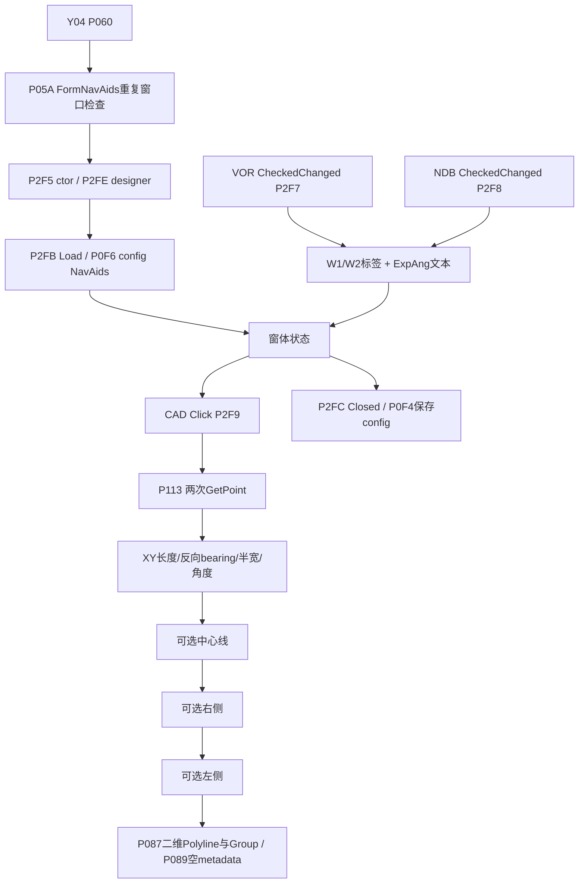

# 完整事件与可达性

命令原P061/处理P060→检查同名窗口计数P05A→new Form _0089_008A→ShowModelessDialog。完整窗体只有五个绑定事件，没有clear/reset按钮或独立设施/航迹拾点按钮，取点包含在CAD按钮事件内。

|Control / UI text|Event|处理token|原token / RVA|处理RVA|分类|
|---|---|---|---|---|---|
|radioButton2 / NDB保护区|CheckedChanged|0x060002F8|0x060002F9 / 0x3DF28|0x3356C|reachable|
|radioButton1 / VOR保护区|CheckedChanged|0x060002F7|0x060002F8 / 0x3DE68|0x33514|reachable|
|buttonNdb / CAD|Click|0x060002F9|0x060002FA / 0x3DFF4|0x335CC|reachable|
|FormNavAids / FormNavAids|FormClosed|0x060002FC|0x060002FD / 0x3E9C8|0x42F2|reachable|
|FormNavAids / FormNavAids|Load|0x060002FB|0x060002FC / 0x3E9A4|0x42D6|reachable|

## 非事件控件与优先级

|功能|控制/读取|是否仅显示|
|---|---|---|
|width W1/W2|radioButtonW1.Checked决定选W1，否则选W2；读取所选按钮Text的数字部分|改变实际几何；无独立Changed事件|
|expansion|textBoxExpAng.Text→P2FA→弧度|设计器禁用；仍从文本读，config可回填；无TextChanged验证|
|left/right|checkBoxLeft/Right.Checked→分支|控制是否构造整个单侧列表；无独立writer|
|center|checkBoxCenter.Checked|只控制中心线输出，不影响边界计算|
|15°|checkBoxExpand.Checked|改变两个边界终点并新增斜边，不是单纯显示|
|facility point/track|CAD按钮里两次GetPoint|第2点同时决定长度，非仅方向|
|clear/reset|无控件/绑定/删除事件|No implementation evidence found in A4.|

P2F7/P2F8不检查自身radio.Checked；false/true状态变化都执行回填，最后实际执行的handler决定标签/角度。Draw不再检查VOR/NDB Radio；几何消费的是此前形成的文本状态。独立适配器明确控制事件次序，不宣称穷尽真实WinForms重入。checkBox没有事件不等于无效，它们都在P2F9读取。

P2F6为native user32.dll SetFocus，RVA0非stub。P300/P301为true/false不透明helper。没有发现orphan evaluator、prompt-only评价入口或stub业务按钮。可达闭包74个内部方法，含公共配置接口路径；MethodSpec解析到外部MemberRef，不漏记成内部业务。

[完整callee/CAD API身份CSV](evidence/event-identities.csv)、[事件闭包](evidence/event-reachability.json)、[MethodSpec解析](evidence/methodspec-resolution.csv)、[DOT调用图](evidence/callgraph.dot)。直接CAD API还包括公共P113的GetPoint与P087/P089/P134的数据库API，不能只看handler本身的外部调用。

## 证据等级与审计入口

E0原程序集身份/元数据；E1处理后反编译；E2 IL/调用/字段恢复；E3独立恢复源码验证；E4原插件运行，本轮无；N规范解释。Pxxx为处理后MethodDef 0x06000xxx，不能当原token；原保护桩本身不证明恢复公式。没有运行目标DLL、AutoCAD或未知EXE。

[方法身份/原处理RVA与IL哈希](evidence/method-index.csv)、[事件完整身份与callee](evidence/event-identities.csv)、[分支](evidence/branch-sites.csv)、[字段](evidence/field-flow.csv)、[控件状态](evidence/parameter-control-inventory.csv)、[表达式](evidence/geometry-expressions.csv)。完整原/处理IL在evidence/raw与processed；[Form源摘录](evidence/FormNavAids.source.txt)保留真实源行。

## 关键定位

|P|原token / RVA|处理RVA|源行|证据|
|---|---|---|---|---|
|P060|0x06000061 / 0x3B7C|0x2BEC|525|[证据](evidence/processed/0x06000060.il.txt)|
|P05A|0x0600005B / 0x38F4|0x7908|439|[证据](evidence/processed/0x0600005A.il.txt)|
|P2F5|0x060002F6 / 0x3DE50|0x42C8|22674|[证据](evidence/processed/0x060002F5.il.txt)|
|P2F6|0x060002F7 / 0x0|0x0||[证据](evidence/native-import.json)|
|P2F7|0x060002F8 / 0x3DE68|0x33514|22682|[证据](evidence/processed/0x060002F7.il.txt)|
|P2F8|0x060002F9 / 0x3DF28|0x3356C|22693|[证据](evidence/processed/0x060002F8.il.txt)|
|P2F9|0x060002FA / 0x3DFF4|0x335CC|22708|[证据](evidence/processed/0x060002F9.il.txt)|
|P2FB|0x060002FC / 0x3E9A4|0x42D6|23091|[证据](evidence/processed/0x060002FB.il.txt)|
|P2FC|0x060002FD / 0x3E9C8|0x42F2|23096|[证据](evidence/processed/0x060002FC.il.txt)|
|P2FE|0x060002FF / 0x3EAA8|0x33EDC|23111|[证据](evidence/processed/0x060002FE.il.txt)|
|P2FF|0x06000300 / 0x3FBB0|0x433D|23695|[证据](evidence/processed/0x060002FF.il.txt)|
