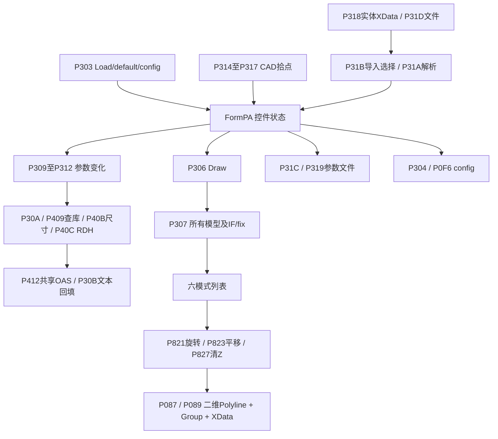

# 事件、可达性与分类

20个真实事件绑定见下表，完整 direct callees 不截断地保存在 CSV。设计器绑定不等于每种 UI 状态都可点击；实际运行的 config 覆盖与事件时序未执行。

|Control|Event|处理P|原token / RVA|处理RVA|分类|
|---|---|---|---|---|---|
|comboBoxCat|SelectedIndexChanged|P30C|0x0600030D / 0x41110|0x35F34|reachable|
|comboBoxGP|SelectedIndexChanged|P30D|0x0600030E / 0x4134C|0x36058|reachable|
|comboBoxMissCG|SelectedIndexChanged|P30E|0x0600030F / 0x41434|0x4387|reachable|
|comboBoxAppType|SelectedIndexChanged|P309|0x0600030A / 0x408A0|0x3584C|reachable|
|textBoxWheel|Validated|P310|0x06000311 / 0x4145C|0x4387|reachable|
|textBoxWing|Validated|P30F|0x06000310 / 0x41448|0x4387|reachable|
|button3|Click|P318|0x06000319 / 0x41B08|0x36418|reachable|
|FormPA|FormClosed|P304|0x06000305 / 0x3FDCC|0x436B|reachable|
|FormPA|Load|P303|0x06000304 / 0x3FC0C|0x34E4C|reachable|
|buttonDraw|Click|P306|0x06000307 / 0x3FDF0|0x34FDC|reachable|
|button5|Click|P31C|0x0600031D / 0x43558|0x37BD0|reachable|
|button4|Click|P314|0x06000315 / 0x41610|0x36188|reachable|
|button10|Click|P313|0x06000314 / 0x41498|0x360D0|reachable|
|button1|Click|P316|0x06000317 / 0x418A8|0x362EC|reachable|
|button6|Click|P315|0x06000316 / 0x41768|0x36240|reachable|
|LocDistance|Validated|P311|0x06000312 / 0x41470|0x4387|reachable|
|button2|Click|P317|0x06000318 / 0x419E8|0x3638C|reachable|
|textBoxRDH|Validated|P312|0x06000313 / 0x41484|0x4387|reachable|
|radioButtonPsLeft|CheckedChanged|P308|0x06000309 / 0x407C8|0x357FC|reachable|
|button7|Click|P31D|0x0600031E / 0x43730|0x37CDC|reachable|

## 入口、未绑定与缺失的分类

|功能|分类及证据|
|---|---|
|THR/end拾点、交换|P314/P315/P313，reachable；六个XYZ文本直接交换|
|坐标转换|没有对应 A5 控件/事件/坐标系协议，未找到实现；Lon/Lat命名不证明经纬转换|
|跑道校验|数值parse与公共两点frame；未见本窗体坐标系、零长或合法跑道校验器|
|CAT/GP/尺寸/RDH/LOC/CG|P309/P30C–P312 → P30A，reachable；表格见控件清单|
|W/W*/X/Y/Z手输|P307读取；不是每个文本都有独立重算事件|
|六radio|都由 P306读取；只有PAOAS Left绑定P308 CheckedChanged，Right无独立绑定，通过同组Left状态变化可能触发|
|ScreenData/Evaluate/Mark/Highlight/Minimums|未见控件/绑定/调度；没有可指认的prompt-only或stub评价按钮|
|P41B、P429|orphan complete method；无全局direct/MethodSpec incoming，无A5事件路径|
|GPINOP P3A7延伸|orphan complete method；不能因类内存在就算Draw输出|
|P305|native user32.dll SetFocus，RVA0不是空stub；导入元数据另存|

[可达闭包](evidence/event-reachability.json)、[全局incoming](evidence/resolved-global-incoming.csv)、[控件属性与消费者](evidence/parameter-control-inventory.csv)、[完整调用DOT](evidence/callgraph.dot)。unbound仅用于真实存在但无绑定的成员；不存在的业务入口不虚构为unbound方法。

## 证据与复核

E0＝原程序集身份/元数据；E1＝处理反编译；E2＝IL/字段/调用恢复；E3＝独立恢复源码检查；E4＝原插件运行，本轮无；N＝规范解释。Pxxx 指处理后 MethodDef 0x06000xxx，不是原 token。原方法可能为保护桩，token/RVA 不单独证明公式。

[方法身份、RVA及IL哈希](evidence/method-index.csv)、[恢复方法映射](evidence/recovery-method-map.csv)、[签名](evidence/signatures.csv)、[事件完整身份](evidence/event-identities.csv)。完整原/处理 IL 位于 evidence/raw 和 evidence/processed；按 token 命名。以下结论限于本构建和静态可见路径，不排除无法证明的外部反射调用。

## 关键定位

|P|原 MethodDef / RVA|处理 RVA|反编译行|处理 IL|
|---|---|---|---|---|
|P303|0x06000304 / 0x3FC0C|0x34E4C|23916|[证据](evidence/processed/0x06000303.il.txt)|
|P304|0x06000305 / 0x3FDCC|0x436B|24008|[证据](evidence/processed/0x06000304.il.txt)|
|P305|0x06000306 / 0x0|0x0||[证据](evidence/native-import.json)|
|P306|0x06000307 / 0x3FDF0|0x34FDC|24016|[证据](evidence/processed/0x06000306.il.txt)|
|P307|0x06000308 / 0x401EC|0x3537C|24174|[证据](evidence/processed/0x06000307.il.txt)|
|P313|0x06000314 / 0x41498|0x360D0|24621|[证据](evidence/processed/0x06000313.il.txt)|
|P314|0x06000315 / 0x41610|0x36188|24652|[证据](evidence/processed/0x06000314.il.txt)|
|P315|0x06000316 / 0x41768|0x36240|24674|[证据](evidence/processed/0x06000315.il.txt)|
|P316|0x06000317 / 0x418A8|0x362EC|24691|[证据](evidence/processed/0x06000316.il.txt)|
|P317|0x06000318 / 0x419E8|0x3638C|24726|[证据](evidence/processed/0x06000317.il.txt)|
|P318|0x06000319 / 0x41B08|0x36418|24747|[证据](evidence/processed/0x06000318.il.txt)|
|P31C|0x0600031D / 0x43558|0x37BD0|25487|[证据](evidence/processed/0x0600031C.il.txt)|
|P31D|0x0600031E / 0x43730|0x37CDC|25533|[证据](evidence/processed/0x0600031D.il.txt)|
|P41B|0x0600041C / 0x65268|0x52DA4|42448|[证据](evidence/processed/0x0600041B.il.txt)|
|P429|0x0600042A / 0x679E0|0x55010|43908|[证据](evidence/processed/0x06000429.il.txt)|
