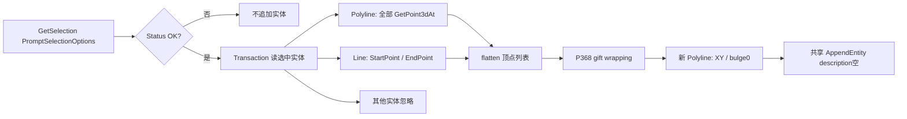

# 实体输入 Envelope

两个“包络线”按钮共用P367（original P368/RVA0x51F40）；点集算法P368（original P369/RVA0x523FC），方向P369（original P36A/RVA0x52534）。证据：FormTemplate源32627–32953、对应processed IL、raw占位方法及token映射。

## 输入到输出



没有SelectionFilter，也不限制同方向或Closed，不读bulge、layer、Group、WsObject、模板Kind或原构造输入。普通Polyline与Line同样进入算法；Circle、Arc、Spline等不转换为采样点。

P368：点数<3直接返回原列表；否则起点取最小Y、同Y最小X。每轮从points[0]作候选，遍历所有点，如果candidate等于current或者orientation==2就替换。追加候选，直到回到起点。方向式：

```text
q=(b.Y−a.Y)(c.X−b.X)−(b.X−a.X)(c.Y−b.Y)
q==0 →0；q>0 →1；else →2
```

这是Jarvis/gift-wrapping式**点集凸包尝试**。非退化例生成凸包，但没有共线最远点tie-break，所以不能宣称所有输入都得到正确凸包。没有逐方向最大半径、IntersectWith、Union、Offset或曲线交点拼接。

输出重复起点但没有设置Closed=true；所有bulge=0，不保留输入圆弧。XY用于写图，选择读出的Z仍参与宿主Point3d相等比较。无原图元Erase/重建，原模板保留；description空所以无WsObject，无模板类型metadata。OK但没有可用顶点仍构造空Polyline并尝试append，不能与cancel混为一谈；实际宿主是否接受该实体未运行验证。

## 共线异常：保留、可复核

`fixtures/envelope-collinear-order.json`：

|输入顺序|恢复状态前缀|结果|
|---|---|---|
|(0,0),(1,0),(2,0)|0→1→0|提前闭合，漏掉最远点2|
|(2,0),(1,0),(0,0)|0→2→1→2…|进入不包含起点的循环|

该fixture由外部有界状态观察器记录相同转移；未向恢复Hull增加次数限制。早期直接执行退化例曾令独立测试进程OOM，见 `../round4/failure-note.md`；此事实不作为原插件运行崩溃证据。

适配器用精确XYZ值相等替代宿主Point3d运算符。原IL确证调用宿主 `op_Equality/op_Inequality`，未静态恢复其容差内部；当前整数测试不依赖近等点容差。近等点行为仍属宿主待核对项。Holding类内的相似包络用自定义**引用类型**TemplatePoint的引用相等；不能按相同MethodDef处理。

## 手工选择的业务意义

只能证明“用户选定的实体→全部顶点→包络”。代码没有自动关联程序的索引，也不读取已有Group/XData判定集合。“为什么作者未自动知道这些模板属于同一程序”应标为 **Legacy UI / design intent unknown**。未来在调用方持有模板列表时可提供同样输入；这是自动化可行性判断，不是旧程序已有功能。

## 验证

nested/overlap/crossing均用三条简单Polyline，保存原输入/输出；正常例反转实体次序面积一致，不意味着所有输入顺序无关。另测single、empty/cancel、Line/Circle、忽略closed/bulge及退化共线次序。`Envelope.Recovered.cs`单独恢复，不耦合到单模板构造器。

P36A（注意不同于original P36A）是**未绑定**的Region.CreateFromCurves/BooleanOperation/Explode代码。未从两个按钮调用它，不得以它的Union描述当前Envelope。
