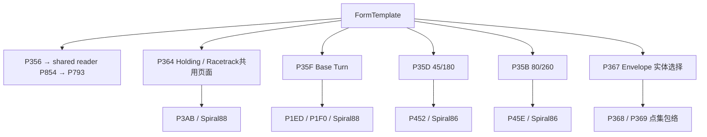

# A6 事件图

证据等级：绑定来自反编译初始化器；token/RVA 来自程序集元数据索引；IL 调用见 evidence/calls.csv。表中 token 均标明 processed/original，不将 UI 名称视为独立业务算法。

## 业务入口与未绑定代码

等待/直角航线页只有 buttonHolding，未找到独立 Racetrack CAD 按钮、事件或模式开关；相同页面标题不能证明存在两套实现。普通 Holding 不使用等待页设施和台高构造容差；全向 Holding 才由 P378 读取这些字段。

Base Turn MOC=300 只在未绑定 P363 障碍物评价方法读取，不进入当前已绑定几何链。P36A 是未绑定 Region 合并方法，P367 才是两个 Envelope 按钮的已绑定处理器。不得把 P36A 的 Union 行为归入 P367。

## buttonBasetTurn.Click

Handler `_0087_009A_008D`; 0x0600035F / 0x06000360 / original RVA 0x50D08; processed RVA 0x42FCC; source line 32239; binding line 34087.

| Direct callee (processed) | Name | IL sites |
|---|---|---|
| 0x0600037D | `\x89\x93.\x89\x92::\x875` | IL_0000 |
| 0x0600037E | `\x89\x93.\x89\x92::\x876` | IL_0005 |
| 0x06000886 | `\x90\x9c.\x90\x9b::\x8b\x8f\x9a` | IL_0012 |
| 0x06000356 | `\x89\x93.\x89\x92::\x87\x99\x9d` | IL_0020 |
| 0x06000358 | `\x89\x93.\x89\x92::\x87\x9a\x86` | IL_0026 |
| 0x0A0001EE | `System.Windows.Forms.Control::get_Text` | IL_0032, IL_0056, IL_0246, IL_02BE |
| 0x06000888 | `\x90\x9c.\x90\x9b::\x8b\x8f\x9d` | IL_0044, IL_0060, IL_0083, IL_00AA, IL_00E2, IL_00FC, IL_0250, IL_02C8, IL_0370 |
| 0x060007D5 | `\x8f\x8b.\x8f\x8a::\x8b\x87\x9e` | IL_0049, IL_0088, IL_00AF, IL_0101 |
| 0x0A000108 | `System.String::op_Equality` | IL_0065, IL_0255, IL_02CD |
| 0x0A0001F5 | `System.Windows.Forms.CheckBox::get_Checked` | IL_0098, IL_02A3, IL_02AE, IL_02FE, IL_034D |
| 0x0A0001B9 | `Autodesk.AutoCAD.Geometry.Point3d::DistanceTo` | IL_00C4 |
| 0x0A000073 | `System.Double::ToString` | IL_00E7 |
| 0x0A0001F0 | `System.Windows.Forms.Control::set_Text` | IL_00EC |
| 0x060001ED | `\x88\x92.\x88\x91::.ctor` | IL_0112 |
| 0x0A00003E | `Autodesk.AutoCAD.ApplicationServices.Core.Application::get_DocumentManager` | IL_0118 |
| 0x0A00003F | `Autodesk.AutoCAD.ApplicationServices.DocumentCollection::get_MdiActiveDocument` | IL_011D |
| 0x0A000066 | `Autodesk.AutoCAD.DatabaseServices.HostApplicationServices::get_WorkingDatabase` | IL_0122 |
| 0x0A000040 | `Autodesk.AutoCAD.ApplicationServices.Document::get_Editor` | IL_0128 |
| 0x0A000086 | `System.Object::ToString` | IL_012F, IL_0291, IL_02DC, IL_02EE, IL_030D, IL_0326, IL_033D, IL_0361 |
| 0x0A000041 | `Autodesk.AutoCAD.EditorInput.Editor::WriteMessage` | IL_0134, IL_0375 |
| 0x060001EF | `\x88\x92.\x88\x91::\x91\x86` | IL_013B |
| 0x06000805 | `\x8f\x8f.\x8f\x8e::.ctor` | IL_0165 |
| 0x06000822 | `\x8f\x91.\x8f\x90::\x8b\x8a\x95` | IL_0170 |
| 0x06000826 | `\x8f\x91.\x8f\x90::\x8b\x8a\x99` | IL_0179 |
| 0x06000129 | `\x87\x87.\x87\x86::\x8c\x87` | IL_0184 |
| 0x06000825 | `\x8f\x91.\x8f\x90::\x8b\x8a\x98` | IL_0189 |
| 0x0A00009B | `Autodesk.AutoCAD.DatabaseServices.Polyline::.ctor` | IL_0190 |
| 0x0A000124 | `0x1B00000F::get_Item` | IL_019B, IL_01CA, IL_020F |
| 0x0600012A | `\x87\x87.\x87\x86::\x8c\x88` | IL_01A0, IL_01CF, IL_0214 |
| 0x0A0001BC | `Autodesk.AutoCAD.DatabaseServices.Polyline::AddVertexAt` | IL_01C0, IL_0205, IL_0234 |
| 0x0A000275 | `System.Math::Tan` | IL_01EE |
| 0x0A0001C0 | `Autodesk.AutoCAD.DatabaseServices.Polyline::set_Closed` | IL_023B |
| 0x06000125 | `\x87\x87.\x87\x86::\x8b\x9c` | IL_0262, IL_0272 |
| 0x0600012B | `\x87\x87.\x87\x86::\x8c\x89` | IL_0267, IL_0277 |
| 0x0A00031A | `Autodesk.AutoCAD.Geometry.Line3d::.ctor` | IL_027C |
| 0x0A00031B | `Autodesk.AutoCAD.Geometry.Matrix3d::Mirroring` | IL_0281 |
| 0x0A0000C3 | `Autodesk.AutoCAD.DatabaseServices.Entity::TransformBy` | IL_0289 |
| 0x06000089 | `\x8c.\x8b::\x88\x8d` | IL_0296 |
| 0x060001F0 | `\x88\x92.\x88\x91::\x91\x87` | IL_02B3 |
| 0x0600035A | `\x89\x93.\x89\x92::\x87\x9a\x88` | IL_02E1, IL_02F3, IL_032B, IL_0342 |
| 0x06000359 | `\x89\x93.\x89\x92::\x87\x9a\x87` | IL_0312, IL_0366 |
| 0x06000829 | `\x8f\x91.\x8f\x90::\x8b\x8a\x9c` | IL_0320, IL_0337 |
| 0x06000828 | `\x8f\x91.\x8f\x90::\x8b\x8a\x9b` | IL_035B |

CAD API（直接）：Autodesk.AutoCAD.Geometry.Point3d::DistanceTo；Autodesk.AutoCAD.ApplicationServices.Core.Application::get_DocumentManager；Autodesk.AutoCAD.ApplicationServices.DocumentCollection::get_MdiActiveDocument；Autodesk.AutoCAD.DatabaseServices.HostApplicationServices::get_WorkingDatabase；Autodesk.AutoCAD.ApplicationServices.Document::get_Editor；Autodesk.AutoCAD.EditorInput.Editor::WriteMessage；Autodesk.AutoCAD.DatabaseServices.Polyline::.ctor；Autodesk.AutoCAD.DatabaseServices.Polyline::AddVertexAt；Autodesk.AutoCAD.DatabaseServices.Polyline::set_Closed；Autodesk.AutoCAD.Geometry.Line3d::.ctor；Autodesk.AutoCAD.Geometry.Matrix3d::Mirroring；Autodesk.AutoCAD.DatabaseServices.Entity::TransformBy

## buttonCalBT.Click

Handler `_0087_009A_0090`; 0x06000362 / 0x06000363 / original RVA 0x512C0; processed RVA 0x43414; source line 32352; binding line 34101.

| Direct callee (processed) | Name | IL sites |
|---|---|---|
| 0x06000886 | `\x90\x9c.\x90\x9b::\x8b\x8f\x9a` | IL_0005 |
| 0x0600037E | `\x89\x93.\x89\x92::\x876` | IL_000C |
| 0x0600037D | `\x89\x93.\x89\x92::\x875` | IL_0011 |
| 0x06000356 | `\x89\x93.\x89\x92::\x87\x99\x9d` | IL_0025 |
| 0x0A0001EE | `System.Windows.Forms.Control::get_Text` | IL_0030, IL_0052 |
| 0x06000888 | `\x90\x9c.\x90\x9b::\x8b\x8f\x9d` | IL_0041, IL_005C, IL_007E, IL_00A4, IL_00DA |
| 0x060007D5 | `\x8f\x8b.\x8f\x8a::\x8b\x87\x9e` | IL_0046, IL_0083, IL_00A9 |
| 0x0A000108 | `System.String::op_Equality` | IL_0061 |
| 0x0A0001F5 | `System.Windows.Forms.CheckBox::get_Checked` | IL_0092 |
| 0x0A0001B9 | `Autodesk.AutoCAD.Geometry.Point3d::DistanceTo` | IL_00BD |
| 0x0A000073 | `System.Double::ToString` | IL_00DF |
| 0x0A0001F0 | `System.Windows.Forms.Control::set_Text` | IL_00E4 |
| 0x060001ED | `\x88\x92.\x88\x91::.ctor` | IL_00F6 |
| 0x0A00003E | `Autodesk.AutoCAD.ApplicationServices.Core.Application::get_DocumentManager` | IL_00FD |
| 0x0A00003F | `Autodesk.AutoCAD.ApplicationServices.DocumentCollection::get_MdiActiveDocument` | IL_0102 |
| 0x0A000040 | `Autodesk.AutoCAD.ApplicationServices.Document::get_Editor` | IL_0107 |
| 0x0A000086 | `System.Object::ToString` | IL_010E |
| 0x0A000041 | `Autodesk.AutoCAD.EditorInput.Editor::WriteMessage` | IL_0113 |

CAD API（直接）：Autodesk.AutoCAD.Geometry.Point3d::DistanceTo；Autodesk.AutoCAD.ApplicationServices.Core.Application::get_DocumentManager；Autodesk.AutoCAD.ApplicationServices.DocumentCollection::get_MdiActiveDocument；Autodesk.AutoCAD.ApplicationServices.Document::get_Editor；Autodesk.AutoCAD.EditorInput.Editor::WriteMessage

## buttonCalHD.Click

Handler `_0087_009A_0094`; 0x06000366 / 0x06000367 / original RVA 0x51ECC; processed RVA 0x43CC4; source line 32617; binding line 34110.

| Direct callee (processed) | Name | IL sites |
|---|---|---|
| 0x06000356 | `\x89\x93.\x89\x92::\x87\x99\x9d` | IL_0001 |
| 0x0A0001EE | `System.Windows.Forms.Control::get_Text` | IL_000C |
| 0x06000888 | `\x90\x9c.\x90\x9b::\x8b\x8f\x9d` | IL_001D, IL_0033 |
| 0x060007D5 | `\x8f\x8b.\x8f\x8a::\x8b\x87\x9e` | IL_0022, IL_0038 |
| 0x060003AB | `\x89\x99.\x89\x98::.ctor` | IL_003F |
| 0x0A00003E | `Autodesk.AutoCAD.ApplicationServices.Core.Application::get_DocumentManager` | IL_0045 |
| 0x0A00003F | `Autodesk.AutoCAD.ApplicationServices.DocumentCollection::get_MdiActiveDocument` | IL_004A |
| 0x0A000040 | `Autodesk.AutoCAD.ApplicationServices.Document::get_Editor` | IL_004F |
| 0x0A000086 | `System.Object::ToString` | IL_0055 |
| 0x0A000041 | `Autodesk.AutoCAD.EditorInput.Editor::WriteMessage` | IL_005A |

CAD API（直接）：Autodesk.AutoCAD.ApplicationServices.Core.Application::get_DocumentManager；Autodesk.AutoCAD.ApplicationServices.DocumentCollection::get_MdiActiveDocument；Autodesk.AutoCAD.ApplicationServices.Document::get_Editor；Autodesk.AutoCAD.EditorInput.Editor::WriteMessage

## checkBoxInputDist.CheckedChanged

Handler `_0087_009A_008F`; 0x06000361 / 0x06000362 / original RVA 0x512A0; processed RVA 0x45CD; source line 32347; binding line 34420.

| Direct callee (processed) | Name | IL sites |
|---|---|---|
| 0x0A0001F5 | `System.Windows.Forms.CheckBox::get_Checked` | IL_000C |
| 0x0A00027C | `System.Windows.Forms.Control::set_Enabled` | IL_0011 |

CAD API（直接）：无；共用拾点/写入通过 P358/P359/P35A 或共享 writer 间接发生。

## buttonCal80PT.Click

Handler `_0087_009A_008A`; 0x0600035C / 0x0600035D / original RVA 0x50948; processed RVA 0x42C90; source line 32164; binding line 34453.

| Direct callee (processed) | Name | IL sites |
|---|---|---|
| 0x06000356 | `\x89\x93.\x89\x92::\x87\x99\x9d` | IL_0001 |
| 0x0600045E | `\x8b\x89.\x8b\x88::.ctor` | IL_0006 |
| 0x0A00003E | `Autodesk.AutoCAD.ApplicationServices.Core.Application::get_DocumentManager` | IL_000C |
| 0x0A00003F | `Autodesk.AutoCAD.ApplicationServices.DocumentCollection::get_MdiActiveDocument` | IL_0011 |
| 0x0A000040 | `Autodesk.AutoCAD.ApplicationServices.Document::get_Editor` | IL_0016 |
| 0x0A000086 | `System.Object::ToString` | IL_001C |
| 0x06000888 | `\x90\x9c.\x90\x9b::\x8b\x8f\x9d` | IL_0026 |
| 0x0A00008B | `System.String::Concat` | IL_002B |
| 0x0A000041 | `Autodesk.AutoCAD.EditorInput.Editor::WriteMessage` | IL_0030 |

CAD API（直接）：Autodesk.AutoCAD.ApplicationServices.Core.Application::get_DocumentManager；Autodesk.AutoCAD.ApplicationServices.DocumentCollection::get_MdiActiveDocument；Autodesk.AutoCAD.ApplicationServices.Document::get_Editor；Autodesk.AutoCAD.EditorInput.Editor::WriteMessage

## button80PT.Click

Handler `_0087_009A_0089`; 0x0600035B / 0x0600035C / original RVA 0x50648; processed RVA 0x42A08; source line 32093; binding line 34538.

| Direct callee (processed) | Name | IL sites |
|---|---|---|
| 0x0600037E | `\x89\x93.\x89\x92::\x876` | IL_0001 |
| 0x0600037D | `\x89\x93.\x89\x92::\x875` | IL_0009 |
| 0x06000886 | `\x90\x9c.\x90\x9b::\x8b\x8f\x9a` | IL_0015 |
| 0x06000356 | `\x89\x93.\x89\x92::\x87\x99\x9d` | IL_0020 |
| 0x06000358 | `\x89\x93.\x89\x92::\x87\x9a\x86` | IL_0026 |
| 0x0600045E | `\x8b\x89.\x8b\x88::.ctor` | IL_002C |
| 0x0A00003E | `Autodesk.AutoCAD.ApplicationServices.Core.Application::get_DocumentManager` | IL_0035 |
| 0x0A00003F | `Autodesk.AutoCAD.ApplicationServices.DocumentCollection::get_MdiActiveDocument` | IL_003A |
| 0x0A000066 | `Autodesk.AutoCAD.DatabaseServices.HostApplicationServices::get_WorkingDatabase` | IL_003F |
| 0x0A000040 | `Autodesk.AutoCAD.ApplicationServices.Document::get_Editor` | IL_0045 |
| 0x0A000086 | `System.Object::ToString` | IL_004C, IL_01F9, IL_0249, IL_0261 |
| 0x0A000041 | `Autodesk.AutoCAD.EditorInput.Editor::WriteMessage` | IL_0051, IL_0275 |
| 0x06000460 | `\x8b\x89.\x8b\x88::\x88\x98\x96` | IL_0058 |
| 0x06000805 | `\x8f\x8f.\x8f\x8e::.ctor` | IL_0080 |
| 0x06000822 | `\x8f\x91.\x8f\x90::\x8b\x8a\x95` | IL_008B |
| 0x06000826 | `\x8f\x91.\x8f\x90::\x8b\x8a\x99` | IL_0092 |
| 0x06000129 | `\x87\x87.\x87\x86::\x8c\x87` | IL_009D |
| 0x06000825 | `\x8f\x91.\x8f\x90::\x8b\x8a\x98` | IL_00A2 |
| 0x0A00009B | `Autodesk.AutoCAD.DatabaseServices.Polyline::.ctor` | IL_00A8 |
| 0x0A000124 | `0x1B00000F::get_Item` | IL_00B2, IL_00E0, IL_0114, IL_0142, IL_0175 |
| 0x0600012A | `\x87\x87.\x87\x86::\x8c\x88` | IL_00B7, IL_00E5, IL_0119, IL_0147, IL_017A |
| 0x0A0001BC | `Autodesk.AutoCAD.DatabaseServices.Polyline::AddVertexAt` | IL_00D7, IL_010B, IL_0139, IL_016C, IL_019A |
| 0x0A000275 | `System.Math::Tan` | IL_00F3, IL_0155 |
| 0x0A0001C0 | `Autodesk.AutoCAD.DatabaseServices.Polyline::set_Closed` | IL_01A1 |
| 0x0A0001EE | `System.Windows.Forms.Control::get_Text` | IL_01AC, IL_0222 |
| 0x06000888 | `\x90\x9c.\x90\x9b::\x8b\x8f\x9d` | IL_01B6, IL_022C, IL_0270 |
| 0x0A000108 | `System.String::op_Equality` | IL_01BB, IL_0231 |
| 0x06000125 | `\x87\x87.\x87\x86::\x8b\x9c` | IL_01C8, IL_01D8 |
| 0x0600012B | `\x87\x87.\x87\x86::\x8c\x89` | IL_01CD, IL_01DD |
| 0x0A00031A | `Autodesk.AutoCAD.Geometry.Line3d::.ctor` | IL_01E2 |
| 0x0A00031B | `Autodesk.AutoCAD.Geometry.Matrix3d::Mirroring` | IL_01E7 |
| 0x0A0000C3 | `Autodesk.AutoCAD.DatabaseServices.Entity::TransformBy` | IL_01F1 |
| 0x06000089 | `\x8c.\x8b::\x88\x8d` | IL_01FE |
| 0x0A0001F5 | `System.Windows.Forms.CheckBox::get_Checked` | IL_020B |
| 0x06000461 | `\x8b\x89.\x8b\x88::\x88\x98\x97` | IL_0210 |
| 0x0A0001D5 | `0x1B000001::.ctor` | IL_0215 |
| 0x06000828 | `\x8f\x91.\x8f\x90::\x8b\x8a\x9b` | IL_023E |
| 0x06000359 | `\x89\x93.\x89\x92::\x87\x9a\x87` | IL_024E, IL_0266 |

CAD API（直接）：Autodesk.AutoCAD.ApplicationServices.Core.Application::get_DocumentManager；Autodesk.AutoCAD.ApplicationServices.DocumentCollection::get_MdiActiveDocument；Autodesk.AutoCAD.DatabaseServices.HostApplicationServices::get_WorkingDatabase；Autodesk.AutoCAD.ApplicationServices.Document::get_Editor；Autodesk.AutoCAD.EditorInput.Editor::WriteMessage；Autodesk.AutoCAD.DatabaseServices.Polyline::.ctor；Autodesk.AutoCAD.DatabaseServices.Polyline::AddVertexAt；Autodesk.AutoCAD.DatabaseServices.Polyline::set_Closed；Autodesk.AutoCAD.Geometry.Line3d::.ctor；Autodesk.AutoCAD.Geometry.Matrix3d::Mirroring；Autodesk.AutoCAD.DatabaseServices.Entity::TransformBy

## buttonCal45PT.Click

Handler `_0087_009A_008C`; 0x0600035E / 0x0600035F / original RVA 0x50CA0; processed RVA 0x42F6C; source line 32231; binding line 34680.

| Direct callee (processed) | Name | IL sites |
|---|---|---|
| 0x06000356 | `\x89\x93.\x89\x92::\x87\x99\x9d` | IL_0001 |
| 0x0A0001EE | `System.Windows.Forms.Control::get_Text` | IL_000C |
| 0x06000888 | `\x90\x9c.\x90\x9b::\x8b\x8f\x9d` | IL_0016, IL_0042 |
| 0x060007D4 | `\x8f\x8b.\x8f\x8a::\x8b\x87\x9d` | IL_001B |
| 0x06000452 | `\x8b\x87.\x8b\x86::.ctor` | IL_0022 |
| 0x0A00003E | `Autodesk.AutoCAD.ApplicationServices.Core.Application::get_DocumentManager` | IL_0028 |
| 0x0A00003F | `Autodesk.AutoCAD.ApplicationServices.DocumentCollection::get_MdiActiveDocument` | IL_002D |
| 0x0A000040 | `Autodesk.AutoCAD.ApplicationServices.Document::get_Editor` | IL_0032 |
| 0x0A000086 | `System.Object::ToString` | IL_0038 |
| 0x0A00008B | `System.String::Concat` | IL_0047 |
| 0x0A000041 | `Autodesk.AutoCAD.EditorInput.Editor::WriteMessage` | IL_004C |

CAD API（直接）：Autodesk.AutoCAD.ApplicationServices.Core.Application::get_DocumentManager；Autodesk.AutoCAD.ApplicationServices.DocumentCollection::get_MdiActiveDocument；Autodesk.AutoCAD.ApplicationServices.Document::get_Editor；Autodesk.AutoCAD.EditorInput.Editor::WriteMessage

## comboBoxBtDistTime.SelectedIndexChanged

Handler `_0087_009A_008E`; 0x06000360 / 0x06000361 / original RVA 0x5112C; processed RVA 0x43354; source line 32324; binding line 34749.

| Direct callee (processed) | Name | IL sites |
|---|---|---|
| 0x0A0001EE | `System.Windows.Forms.Control::get_Text` | IL_0006 |
| 0x06000888 | `\x90\x9c.\x90\x9b::\x8b\x8f\x9d` | IL_0010, IL_0027, IL_0062 |
| 0x0A000108 | `System.String::op_Equality` | IL_0015 |
| 0x0A0001F0 | `System.Windows.Forms.Control::set_Text` | IL_002C, IL_0067 |
| 0x0A000232 | `System.Windows.Forms.Control::set_Width` | IL_0039, IL_0074 |
| 0x0A00027C | `System.Windows.Forms.Control::set_Enabled` | IL_0045, IL_0097 |
| 0x0A00027A | `System.Windows.Forms.Control::set_Visible` | IL_0051, IL_00AD |
| 0x0600037D | `\x89\x93.\x89\x92::\x875` | IL_0079, IL_009F |
| 0x0600037E | `\x89\x93.\x89\x92::\x876` | IL_007E |
| 0x0A0001F5 | `System.Windows.Forms.CheckBox::get_Checked` | IL_0092 |

CAD API（直接）：无；共用拾点/写入通过 P358/P359/P35A 或共享 writer 间接发生。

## button1.Click

Handler `_0087_009A_0095`; 0x06000367 / 0x06000368 / original RVA 0x51F40; processed RVA 0x43D30; source line 32627; binding line 34786.

| Direct callee (processed) | Name | IL sites |
|---|---|---|
| 0x0600037E | `\x89\x93.\x89\x92::\x876` | IL_000C, IL_0026, IL_0076, IL_008F, IL_00A1, IL_0112, IL_02ED |
| 0x0A00031D | `0x1B000032::.ctor` | IL_0035 |
| 0x0A00007D | `Autodesk.AutoCAD.DatabaseServices.Database::get_TransactionManager` | IL_003C |
| 0x0A00007E | `Autodesk.AutoCAD.DatabaseServices.TransactionManager::StartTransaction` | IL_0041 |
| 0x0A0000F2 | `Autodesk.AutoCAD.EditorInput.PromptSelectionResult::get_Value` | IL_004F |
| 0x0A00031E | `Autodesk.AutoCAD.EditorInput.SelectionSet::GetEnumerator` | IL_0054 |
| 0x0A0000E4 | `System.Collections.IEnumerator::get_Current` | IL_0063 |
| 0x0A00031F | `Autodesk.AutoCAD.EditorInput.SelectedObject::get_ObjectId` | IL_00F9 |
| 0x0A000080 | `Autodesk.AutoCAD.DatabaseServices.Transaction::GetObject` | IL_00FF |
| 0x0A0001BB | `Autodesk.AutoCAD.DatabaseServices.Curve::get_StartPoint` | IL_014B |
| 0x0A000320 | `0x1B000032::Add` | IL_0150, IL_015D, IL_0178 |
| 0x0A0001BF | `Autodesk.AutoCAD.DatabaseServices.Curve::get_EndPoint` | IL_0158 |
| 0x0A000321 | `Autodesk.AutoCAD.DatabaseServices.Polyline::GetPoint3dAt` | IL_0173 |
| 0x0A000322 | `Autodesk.AutoCAD.DatabaseServices.Polyline::get_NumberOfVertices` | IL_0187, IL_02FE |
| 0x0A0000E6 | `System.Collections.IEnumerator::MoveNext` | IL_0190 |
| 0x0A000087 | `System.IDisposable::Dispose` | IL_01AB, IL_01C0, IL_034C |
| 0x0A0000A4 | `Autodesk.AutoCAD.DatabaseServices.Transaction::Commit` | IL_01B3 |
| 0x06000368 | `\x89\x93.\x89\x92::\x87\x9a\x96` | IL_0203 |
| 0x0A00009B | `Autodesk.AutoCAD.DatabaseServices.Polyline::.ctor` | IL_0208 |
| 0x0A000323 | `0x1B000032::GetEnumerator` | IL_020F |
| 0x0600037D | `\x89\x93.\x89\x92::\x875` | IL_021C, IL_02F2 |
| 0x0A0000F1 | `Autodesk.AutoCAD.EditorInput.PromptSelectionResult::get_Status` | IL_0226 |
| 0x0A0000F0 | `Autodesk.AutoCAD.EditorInput.Editor::GetSelection` | IL_0244 |
| 0x0A00027A | `System.Windows.Forms.Control::set_Visible` | IL_024C, IL_02BF |
| 0x06000888 | `\x90\x9c.\x90\x9b::\x8b\x8f\x9d` | IL_0260, IL_0273 |
| 0x0A000324 | `Autodesk.AutoCAD.EditorInput.PromptSelectionOptions::set_MessageForRemoval` | IL_0265 |
| 0x0A000325 | `Autodesk.AutoCAD.EditorInput.PromptSelectionOptions::set_MessageForAdding` | IL_0278 |
| 0x0A0000EF | `Autodesk.AutoCAD.EditorInput.PromptSelectionOptions::.ctor` | IL_0285 |
| 0x0A00003E | `Autodesk.AutoCAD.ApplicationServices.Core.Application::get_DocumentManager` | IL_028E |
| 0x0A00003F | `Autodesk.AutoCAD.ApplicationServices.DocumentCollection::get_MdiActiveDocument` | IL_0293 |
| 0x0A000079 | `Autodesk.AutoCAD.ApplicationServices.Document::get_Database` | IL_0299 |
| 0x0A000040 | `Autodesk.AutoCAD.ApplicationServices.Document::get_Editor` | IL_02A0 |
| 0x0A000278 | `Autodesk.AutoCAD.ApplicationServices.Document::get_Window` | IL_02A7 |
| 0x0A000279 | `Autodesk.AutoCAD.Windows.Window::get_Handle` | IL_02AC |
| 0x06000353 | `\x89\x93.\x89\x92::\x87\x99\x9a` | IL_02B1 |
| 0x06000886 | `\x90\x9c.\x90\x9b::\x8b\x8f\x9a` | IL_02D1 |
| 0x0A000326 | `0x1B000033::get_Current` | IL_02E6 |
| 0x0A000062 | `Autodesk.AutoCAD.Geometry.Point3d::get_X` | IL_0305 |
| 0x0A000061 | `Autodesk.AutoCAD.Geometry.Point3d::get_Y` | IL_030C |
| 0x0A000117 | `Autodesk.AutoCAD.Geometry.Point2d::.ctor` | IL_0311 |
| 0x0A0001BC | `Autodesk.AutoCAD.DatabaseServices.Polyline::AddVertexAt` | IL_0331 |
| 0x0A000327 | `0x1B000033::MoveNext` | IL_033B |
| 0x06000089 | `\x8c.\x8b::\x88\x8d` | IL_035A |

CAD API（直接）：Autodesk.AutoCAD.DatabaseServices.Database::get_TransactionManager；Autodesk.AutoCAD.DatabaseServices.TransactionManager::StartTransaction；Autodesk.AutoCAD.EditorInput.PromptSelectionResult::get_Value；Autodesk.AutoCAD.EditorInput.SelectionSet::GetEnumerator；Autodesk.AutoCAD.EditorInput.SelectedObject::get_ObjectId；Autodesk.AutoCAD.DatabaseServices.Transaction::GetObject；Autodesk.AutoCAD.DatabaseServices.Curve::get_StartPoint；Autodesk.AutoCAD.DatabaseServices.Curve::get_EndPoint；Autodesk.AutoCAD.DatabaseServices.Polyline::GetPoint3dAt；Autodesk.AutoCAD.DatabaseServices.Polyline::get_NumberOfVertices；Autodesk.AutoCAD.DatabaseServices.Transaction::Commit；Autodesk.AutoCAD.DatabaseServices.Polyline::.ctor；Autodesk.AutoCAD.EditorInput.PromptSelectionResult::get_Status；Autodesk.AutoCAD.EditorInput.Editor::GetSelection；Autodesk.AutoCAD.EditorInput.PromptSelectionOptions::set_MessageForRemoval；Autodesk.AutoCAD.EditorInput.PromptSelectionOptions::set_MessageForAdding；Autodesk.AutoCAD.EditorInput.PromptSelectionOptions::.ctor；Autodesk.AutoCAD.ApplicationServices.Core.Application::get_DocumentManager；Autodesk.AutoCAD.ApplicationServices.DocumentCollection::get_MdiActiveDocument；Autodesk.AutoCAD.ApplicationServices.Document::get_Database；Autodesk.AutoCAD.ApplicationServices.Document::get_Editor；Autodesk.AutoCAD.ApplicationServices.Document::get_Window；Autodesk.AutoCAD.Windows.Window::get_Handle；Autodesk.AutoCAD.Geometry.Point3d::get_X；Autodesk.AutoCAD.Geometry.Point3d::get_Y；Autodesk.AutoCAD.Geometry.Point2d::.ctor；Autodesk.AutoCAD.DatabaseServices.Polyline::AddVertexAt

## buttonOmiHD.Click

Handler `_0087_009B_008C`; 0x06000377 / 0x06000378 / original RVA 0x53D64; processed RVA 0x45310; source line 33815; binding line 34810.

| Direct callee (processed) | Name | IL sites |
|---|---|---|
| 0x0600037E | `\x89\x93.\x89\x92::\x876` | IL_0009, IL_0037 |
| 0x0A000086 | `System.Object::ToString` | IL_0018, IL_0173, IL_01CF, IL_01EF |
| 0x06000359 | `\x89\x93.\x89\x92::\x87\x9a\x87` | IL_001D, IL_0178, IL_01D4, IL_01F4 |
| 0x0600037D | `\x89\x93.\x89\x92::\x875` | IL_0023 |
| 0x06000886 | `\x90\x9c.\x90\x9b::\x8b\x8f\x9a` | IL_0088 |
| 0x06000356 | `\x89\x93.\x89\x92::\x87\x99\x9d` | IL_0093 |
| 0x06000358 | `\x89\x93.\x89\x92::\x87\x9a\x86` | IL_0099 |
| 0x0A0001EE | `System.Windows.Forms.Control::get_Text` | IL_00A5, IL_0142 |
| 0x06000888 | `\x90\x9c.\x90\x9b::\x8b\x8f\x9d` | IL_00B6, IL_00CC, IL_014C, IL_023E |
| 0x060007D5 | `\x8f\x8b.\x8f\x8a::\x8b\x87\x9e` | IL_00BB, IL_00D1 |
| 0x060003AB | `\x89\x99.\x89\x98::.ctor` | IL_00D9 |
| 0x0A0001F5 | `System.Windows.Forms.CheckBox::get_Checked` | IL_00E6, IL_012C |
| 0x060003AD | `\x89\x99.\x89\x98::\x88\x87\x9b` | IL_00EB |
| 0x06000378 | `\x89\x93.\x89\x92::\x87\x9b\x8d` | IL_00F5 |
| 0x060003BD | `\x89\x9b.\x89\x9a::.ctor` | IL_00FC |
| 0x060003C9 | `\x89\x9d.\x89\x9c::.ctor` | IL_0104 |
| 0x060007FC | `\x8f\x8f.\x8f\x8e::\x8b\x89\x96` | IL_0115 |
| 0x060007FE | `\x8f\x8f.\x8f\x8e::\x8b\x89\x98` | IL_0121 |
| 0x060003AF | `\x89\x99.\x89\x98::\x88\x87\x9d` | IL_0131 |
| 0x0A000066 | `Autodesk.AutoCAD.DatabaseServices.HostApplicationServices::get_WorkingDatabase` | IL_0136 |
| 0x0A000108 | `System.String::op_Equality` | IL_0151 |
| 0x2B000014 | `` | IL_0185, IL_0209 |
| 0x06000379 | `\x89\x93.\x89\x92::\x87\x9b\x8e` | IL_019C, IL_0220 |
| 0x0600035A | `\x89\x93.\x89\x92::\x87\x9a\x88` | IL_01A6, IL_022A |
| 0x06000828 | `\x8f\x91.\x8f\x90::\x8b\x8a\x9b` | IL_01C4, IL_01E9 |
| 0x06000357 | `\x89\x93.\x89\x92::\x87\x99\x9e` | IL_0243 |

CAD API（直接）：Autodesk.AutoCAD.DatabaseServices.HostApplicationServices::get_WorkingDatabase

## buttonYE.Click

Handler `_0087_009B_008B`; 0x06000376 / 0x06000377 / original RVA 0x53B48; processed RVA 0x451D8; source line 33772; binding line 34847.

| Direct callee (processed) | Name | IL sites |
|---|---|---|
| 0x06000886 | `\x90\x9c.\x90\x9b::\x8b\x8f\x9a` | IL_0005 |
| 0x06000356 | `\x89\x93.\x89\x92::\x87\x99\x9d` | IL_0010 |
| 0x06000828 | `\x8f\x91.\x8f\x90::\x8b\x8a\x9b` | IL_001F, IL_00BC, IL_00E0 |
| 0x0A000086 | `System.Object::ToString` | IL_0025, IL_00A4, IL_00C2, IL_00E6, IL_00FD, IL_010F |
| 0x06000359 | `\x89\x93.\x89\x92::\x87\x9a\x87` | IL_002A, IL_00A9, IL_00C7, IL_00EB, IL_0102, IL_0114 |
| 0x0600037E | `\x89\x93.\x89\x92::\x876` | IL_002F, IL_00AE, IL_00CC |
| 0x06000358 | `\x89\x93.\x89\x92::\x87\x9a\x86` | IL_0037 |
| 0x0A0001EE | `System.Windows.Forms.Control::get_Text` | IL_0043, IL_0083 |
| 0x06000888 | `\x90\x9c.\x90\x9b::\x8b\x8f\x9d` | IL_0054, IL_006A, IL_008D, IL_011F |
| 0x060007D5 | `\x8f\x8b.\x8f\x8a::\x8b\x87\x9e` | IL_0059, IL_006F |
| 0x060003C9 | `\x89\x9d.\x89\x9c::.ctor` | IL_0077 |
| 0x0A000108 | `System.String::op_Equality` | IL_0092 |
| 0x0600037D | `\x89\x93.\x89\x92::\x875` | IL_00D1 |
| 0x06000357 | `\x89\x93.\x89\x92::\x87\x99\x9e` | IL_0124 |

CAD API（直接）：无；共用拾点/写入通过 P358/P359/P35A 或共享 writer 间接发生。

## buttonXE.Click

Handler `_0087_009B_008A`; 0x06000375 / 0x06000376 / original RVA 0x5392C; processed RVA 0x450A8; source line 33734; binding line 34867.

| Direct callee (processed) | Name | IL sites |
|---|---|---|
| 0x06000886 | `\x90\x9c.\x90\x9b::\x8b\x8f\x9a` | IL_0005 |
| 0x0600037D | `\x89\x93.\x89\x92::\x875` | IL_000F, IL_0029 |
| 0x06000356 | `\x89\x93.\x89\x92::\x87\x99\x9d` | IL_0017 |
| 0x06000358 | `\x89\x93.\x89\x92::\x87\x9a\x86` | IL_001E |
| 0x0600037E | `\x89\x93.\x89\x92::\x876` | IL_0024 |
| 0x0A0001EE | `System.Windows.Forms.Control::get_Text` | IL_003A, IL_007A |
| 0x06000888 | `\x90\x9c.\x90\x9b::\x8b\x8f\x9d` | IL_004B, IL_0061, IL_0084, IL_0116 |
| 0x060007D5 | `\x8f\x8b.\x8f\x8a::\x8b\x87\x9e` | IL_0050, IL_0066 |
| 0x060003BD | `\x89\x9b.\x89\x9a::.ctor` | IL_006E |
| 0x0A000108 | `System.String::op_Equality` | IL_0089 |
| 0x0A000086 | `System.Object::ToString` | IL_0098, IL_00AA, IL_00BC, IL_00D5, IL_00EC, IL_0103 |
| 0x06000359 | `\x89\x93.\x89\x92::\x87\x9a\x87` | IL_009D, IL_00AF, IL_00C1, IL_00DA, IL_00F1, IL_0108 |
| 0x06000828 | `\x8f\x91.\x8f\x90::\x8b\x8a\x9b` | IL_00CF, IL_00E6, IL_00FD |
| 0x06000357 | `\x89\x93.\x89\x92::\x87\x99\x9e` | IL_011B |

CAD API（直接）：无；共用拾点/写入通过 P358/P359/P35A 或共享 writer 间接发生。

## buttonHolding.Click

Handler `_0087_009A_0092`; 0x06000364 / 0x06000365 / original RVA 0x51960; processed RVA 0x43840; source line 32511; binding line 34885.

| Direct callee (processed) | Name | IL sites |
|---|---|---|
| 0x06000886 | `\x90\x9c.\x90\x9b::\x8b\x8f\x9a` | IL_0005 |
| 0x0600037D | `\x89\x93.\x89\x92::\x875` | IL_000C |
| 0x0600037E | `\x89\x93.\x89\x92::\x876` | IL_0011 |
| 0x06000356 | `\x89\x93.\x89\x92::\x87\x99\x9d` | IL_0022 |
| 0x06000358 | `\x89\x93.\x89\x92::\x87\x9a\x86` | IL_0029 |
| 0x0A0001EE | `System.Windows.Forms.Control::get_Text` | IL_0035, IL_01BC, IL_0217, IL_0311 |
| 0x06000888 | `\x90\x9c.\x90\x9b::\x8b\x8f\x9d` | IL_0046, IL_005D, IL_01C6, IL_0221, IL_031B, IL_040D, IL_0422, IL_046B |
| 0x060007D5 | `\x8f\x8b.\x8f\x8a::\x8b\x87\x9e` | IL_004B, IL_0062 |
| 0x060003AB | `\x89\x99.\x89\x98::.ctor` | IL_006B |
| 0x0A00003E | `Autodesk.AutoCAD.ApplicationServices.Core.Application::get_DocumentManager` | IL_0072 |
| 0x0A00003F | `Autodesk.AutoCAD.ApplicationServices.DocumentCollection::get_MdiActiveDocument` | IL_0077 |
| 0x0A000066 | `Autodesk.AutoCAD.DatabaseServices.HostApplicationServices::get_WorkingDatabase` | IL_007C |
| 0x0A000040 | `Autodesk.AutoCAD.ApplicationServices.Document::get_Editor` | IL_0082 |
| 0x0A000086 | `System.Object::ToString` | IL_008A, IL_01F4, IL_0237, IL_0252 |
| 0x0A000041 | `Autodesk.AutoCAD.EditorInput.Editor::WriteMessage` | IL_008F, IL_0470 |
| 0x060003AC | `\x89\x99.\x89\x98::\x88\x87\x9a` | IL_0097 |
| 0x06000805 | `\x8f\x8f.\x8f\x8e::.ctor` | IL_00C2, IL_0304, IL_03EE |
| 0x06000822 | `\x8f\x91.\x8f\x90::\x8b\x8a\x95` | IL_00CD |
| 0x06000826 | `\x8f\x91.\x8f\x90::\x8b\x8a\x99` | IL_00D6 |
| 0x06000129 | `\x87\x87.\x87\x86::\x8c\x87` | IL_00E1 |
| 0x06000825 | `\x8f\x91.\x8f\x90::\x8b\x8a\x98` | IL_00E6 |
| 0x0A00009B | `Autodesk.AutoCAD.DatabaseServices.Polyline::.ctor` | IL_00ED |
| 0x0A000124 | `0x1B00000F::get_Item` | IL_00F8, IL_0127, IL_0156, IL_0185, IL_0285, IL_0292, IL_02A0, IL_02AE, IL_02C6, IL_02D3, IL_02E1, IL_02EF |
| 0x0600012A | `\x87\x87.\x87\x86::\x8c\x88` | IL_00FD, IL_012C, IL_015B, IL_018A |
| 0x0A0001BC | `Autodesk.AutoCAD.DatabaseServices.Polyline::AddVertexAt` | IL_011D, IL_014C, IL_017B, IL_01AA |
| 0x0A0001C0 | `Autodesk.AutoCAD.DatabaseServices.Polyline::set_Closed` | IL_01B1 |
| 0x0A000108 | `System.String::op_Equality` | IL_01CB, IL_0226, IL_0320 |
| 0x0A00031A | `Autodesk.AutoCAD.Geometry.Line3d::.ctor` | IL_01DE |
| 0x0A00031B | `Autodesk.AutoCAD.Geometry.Matrix3d::Mirroring` | IL_01E3 |
| 0x0A0000C3 | `Autodesk.AutoCAD.DatabaseServices.Entity::TransformBy` | IL_01EB |
| 0x06000089 | `\x8c.\x8b::\x88\x8d` | IL_01F9, IL_0460 |
| 0x0A0001F5 | `System.Windows.Forms.CheckBox::get_Checked` | IL_0207, IL_0262 |
| 0x060003AD | `\x89\x99.\x89\x98::\x88\x87\x9b` | IL_020C |
| 0x06000359 | `\x89\x93.\x89\x92::\x87\x9a\x87` | IL_023C, IL_0257 |
| 0x06000828 | `\x8f\x91.\x8f\x90::\x8b\x8a\x9b` | IL_024B |
| 0x06000365 | `\x89\x93.\x89\x92::\x87\x9a\x93` | IL_0272 |
| 0x060007FC | `\x8f\x8f.\x8f\x8e::\x8b\x89\x96` | IL_028A, IL_0297, IL_02A5, IL_02B3, IL_035E, IL_03CB |
| 0x060007FE | `\x8f\x8f.\x8f\x8e::\x8b\x89\x98` | IL_02CB, IL_02D8, IL_02E6, IL_02F4, IL_0374, IL_03DF |
| 0x0A000062 | `Autodesk.AutoCAD.Geometry.Point3d::get_X` | IL_0330, IL_033B, IL_0369, IL_039D |
| 0x0A000061 | `Autodesk.AutoCAD.Geometry.Point3d::get_Y` | IL_0349, IL_0354, IL_037F, IL_03B0 |
| 0x0A000315 | `Autodesk.AutoCAD.DatabaseServices.MText::.ctor` | IL_03F5 |
| 0x0600012B | `\x87\x87.\x87\x86::\x8c\x89` | IL_03FD |
| 0x0A000316 | `Autodesk.AutoCAD.DatabaseServices.MText::set_Location` | IL_0402 |
| 0x0A0001B7 | `System.Double::ToString` | IL_0418, IL_042D |
| 0x0A000057 | `System.String::Concat` | IL_0432 |
| 0x0A000317 | `Autodesk.AutoCAD.DatabaseServices.MText::set_Contents` | IL_0437 |
| 0x0A000318 | `Autodesk.AutoCAD.DatabaseServices.MText::set_TextHeight` | IL_0446 |
| 0x0A00031C | `Autodesk.AutoCAD.DatabaseServices.MText::set_Rotation` | IL_044E |
| 0x0A000319 | `Autodesk.AutoCAD.DatabaseServices.MText::set_Attachment` | IL_0455 |

CAD API（直接）：Autodesk.AutoCAD.ApplicationServices.Core.Application::get_DocumentManager；Autodesk.AutoCAD.ApplicationServices.DocumentCollection::get_MdiActiveDocument；Autodesk.AutoCAD.DatabaseServices.HostApplicationServices::get_WorkingDatabase；Autodesk.AutoCAD.ApplicationServices.Document::get_Editor；Autodesk.AutoCAD.EditorInput.Editor::WriteMessage；Autodesk.AutoCAD.DatabaseServices.Polyline::.ctor；Autodesk.AutoCAD.DatabaseServices.Polyline::AddVertexAt；Autodesk.AutoCAD.DatabaseServices.Polyline::set_Closed；Autodesk.AutoCAD.Geometry.Line3d::.ctor；Autodesk.AutoCAD.Geometry.Matrix3d::Mirroring；Autodesk.AutoCAD.DatabaseServices.Entity::TransformBy；Autodesk.AutoCAD.Geometry.Point3d::get_X；Autodesk.AutoCAD.Geometry.Point3d::get_Y；Autodesk.AutoCAD.DatabaseServices.MText::.ctor；Autodesk.AutoCAD.DatabaseServices.MText::set_Location；Autodesk.AutoCAD.DatabaseServices.MText::set_Contents；Autodesk.AutoCAD.DatabaseServices.MText::set_TextHeight；Autodesk.AutoCAD.DatabaseServices.MText::set_Rotation；Autodesk.AutoCAD.DatabaseServices.MText::set_Attachment

## button4.Click

Handler `_0087_009A_0095`; 0x06000367 / 0x06000368 / original RVA 0x51F40; processed RVA 0x43D30; source line 32627; binding line 35161.

| Direct callee (processed) | Name | IL sites |
|---|---|---|
| 0x0600037E | `\x89\x93.\x89\x92::\x876` | IL_000C, IL_0026, IL_0076, IL_008F, IL_00A1, IL_0112, IL_02ED |
| 0x0A00031D | `0x1B000032::.ctor` | IL_0035 |
| 0x0A00007D | `Autodesk.AutoCAD.DatabaseServices.Database::get_TransactionManager` | IL_003C |
| 0x0A00007E | `Autodesk.AutoCAD.DatabaseServices.TransactionManager::StartTransaction` | IL_0041 |
| 0x0A0000F2 | `Autodesk.AutoCAD.EditorInput.PromptSelectionResult::get_Value` | IL_004F |
| 0x0A00031E | `Autodesk.AutoCAD.EditorInput.SelectionSet::GetEnumerator` | IL_0054 |
| 0x0A0000E4 | `System.Collections.IEnumerator::get_Current` | IL_0063 |
| 0x0A00031F | `Autodesk.AutoCAD.EditorInput.SelectedObject::get_ObjectId` | IL_00F9 |
| 0x0A000080 | `Autodesk.AutoCAD.DatabaseServices.Transaction::GetObject` | IL_00FF |
| 0x0A0001BB | `Autodesk.AutoCAD.DatabaseServices.Curve::get_StartPoint` | IL_014B |
| 0x0A000320 | `0x1B000032::Add` | IL_0150, IL_015D, IL_0178 |
| 0x0A0001BF | `Autodesk.AutoCAD.DatabaseServices.Curve::get_EndPoint` | IL_0158 |
| 0x0A000321 | `Autodesk.AutoCAD.DatabaseServices.Polyline::GetPoint3dAt` | IL_0173 |
| 0x0A000322 | `Autodesk.AutoCAD.DatabaseServices.Polyline::get_NumberOfVertices` | IL_0187, IL_02FE |
| 0x0A0000E6 | `System.Collections.IEnumerator::MoveNext` | IL_0190 |
| 0x0A000087 | `System.IDisposable::Dispose` | IL_01AB, IL_01C0, IL_034C |
| 0x0A0000A4 | `Autodesk.AutoCAD.DatabaseServices.Transaction::Commit` | IL_01B3 |
| 0x06000368 | `\x89\x93.\x89\x92::\x87\x9a\x96` | IL_0203 |
| 0x0A00009B | `Autodesk.AutoCAD.DatabaseServices.Polyline::.ctor` | IL_0208 |
| 0x0A000323 | `0x1B000032::GetEnumerator` | IL_020F |
| 0x0600037D | `\x89\x93.\x89\x92::\x875` | IL_021C, IL_02F2 |
| 0x0A0000F1 | `Autodesk.AutoCAD.EditorInput.PromptSelectionResult::get_Status` | IL_0226 |
| 0x0A0000F0 | `Autodesk.AutoCAD.EditorInput.Editor::GetSelection` | IL_0244 |
| 0x0A00027A | `System.Windows.Forms.Control::set_Visible` | IL_024C, IL_02BF |
| 0x06000888 | `\x90\x9c.\x90\x9b::\x8b\x8f\x9d` | IL_0260, IL_0273 |
| 0x0A000324 | `Autodesk.AutoCAD.EditorInput.PromptSelectionOptions::set_MessageForRemoval` | IL_0265 |
| 0x0A000325 | `Autodesk.AutoCAD.EditorInput.PromptSelectionOptions::set_MessageForAdding` | IL_0278 |
| 0x0A0000EF | `Autodesk.AutoCAD.EditorInput.PromptSelectionOptions::.ctor` | IL_0285 |
| 0x0A00003E | `Autodesk.AutoCAD.ApplicationServices.Core.Application::get_DocumentManager` | IL_028E |
| 0x0A00003F | `Autodesk.AutoCAD.ApplicationServices.DocumentCollection::get_MdiActiveDocument` | IL_0293 |
| 0x0A000079 | `Autodesk.AutoCAD.ApplicationServices.Document::get_Database` | IL_0299 |
| 0x0A000040 | `Autodesk.AutoCAD.ApplicationServices.Document::get_Editor` | IL_02A0 |
| 0x0A000278 | `Autodesk.AutoCAD.ApplicationServices.Document::get_Window` | IL_02A7 |
| 0x0A000279 | `Autodesk.AutoCAD.Windows.Window::get_Handle` | IL_02AC |
| 0x06000353 | `\x89\x93.\x89\x92::\x87\x99\x9a` | IL_02B1 |
| 0x06000886 | `\x90\x9c.\x90\x9b::\x8b\x8f\x9a` | IL_02D1 |
| 0x0A000326 | `0x1B000033::get_Current` | IL_02E6 |
| 0x0A000062 | `Autodesk.AutoCAD.Geometry.Point3d::get_X` | IL_0305 |
| 0x0A000061 | `Autodesk.AutoCAD.Geometry.Point3d::get_Y` | IL_030C |
| 0x0A000117 | `Autodesk.AutoCAD.Geometry.Point2d::.ctor` | IL_0311 |
| 0x0A0001BC | `Autodesk.AutoCAD.DatabaseServices.Polyline::AddVertexAt` | IL_0331 |
| 0x0A000327 | `0x1B000033::MoveNext` | IL_033B |
| 0x06000089 | `\x8c.\x8b::\x88\x8d` | IL_035A |

CAD API（直接）：Autodesk.AutoCAD.DatabaseServices.Database::get_TransactionManager；Autodesk.AutoCAD.DatabaseServices.TransactionManager::StartTransaction；Autodesk.AutoCAD.EditorInput.PromptSelectionResult::get_Value；Autodesk.AutoCAD.EditorInput.SelectionSet::GetEnumerator；Autodesk.AutoCAD.EditorInput.SelectedObject::get_ObjectId；Autodesk.AutoCAD.DatabaseServices.Transaction::GetObject；Autodesk.AutoCAD.DatabaseServices.Curve::get_StartPoint；Autodesk.AutoCAD.DatabaseServices.Curve::get_EndPoint；Autodesk.AutoCAD.DatabaseServices.Polyline::GetPoint3dAt；Autodesk.AutoCAD.DatabaseServices.Polyline::get_NumberOfVertices；Autodesk.AutoCAD.DatabaseServices.Transaction::Commit；Autodesk.AutoCAD.DatabaseServices.Polyline::.ctor；Autodesk.AutoCAD.EditorInput.PromptSelectionResult::get_Status；Autodesk.AutoCAD.EditorInput.Editor::GetSelection；Autodesk.AutoCAD.EditorInput.PromptSelectionOptions::set_MessageForRemoval；Autodesk.AutoCAD.EditorInput.PromptSelectionOptions::set_MessageForAdding；Autodesk.AutoCAD.EditorInput.PromptSelectionOptions::.ctor；Autodesk.AutoCAD.ApplicationServices.Core.Application::get_DocumentManager；Autodesk.AutoCAD.ApplicationServices.DocumentCollection::get_MdiActiveDocument；Autodesk.AutoCAD.ApplicationServices.Document::get_Database；Autodesk.AutoCAD.ApplicationServices.Document::get_Editor；Autodesk.AutoCAD.ApplicationServices.Document::get_Window；Autodesk.AutoCAD.Windows.Window::get_Handle；Autodesk.AutoCAD.Geometry.Point3d::get_X；Autodesk.AutoCAD.Geometry.Point3d::get_Y；Autodesk.AutoCAD.Geometry.Point2d::.ctor；Autodesk.AutoCAD.DatabaseServices.Polyline::AddVertexAt

## button45PT.Click

Handler `_0087_009A_008B`; 0x0600035D / 0x0600035E / original RVA 0x50994; processed RVA 0x42CD4; source line 32170; binding line 35425.

| Direct callee (processed) | Name | IL sites |
|---|---|---|
| 0x0600037D | `\x89\x93.\x89\x92::\x875` | IL_0000 |
| 0x0600037E | `\x89\x93.\x89\x92::\x876` | IL_0005 |
| 0x06000886 | `\x90\x9c.\x90\x9b::\x8b\x8f\x9a` | IL_0012 |
| 0x06000356 | `\x89\x93.\x89\x92::\x87\x99\x9d` | IL_0020 |
| 0x06000358 | `\x89\x93.\x89\x92::\x87\x9a\x86` | IL_0026 |
| 0x0A0001EE | `System.Windows.Forms.Control::get_Text` | IL_0032, IL_01CC, IL_0239 |
| 0x06000888 | `\x90\x9c.\x90\x9b::\x8b\x8f\x9d` | IL_003C, IL_01D6, IL_0243, IL_027F |
| 0x060007D4 | `\x8f\x8b.\x8f\x8a::\x8b\x87\x9d` | IL_0041 |
| 0x06000452 | `\x8b\x87.\x8b\x86::.ctor` | IL_004A |
| 0x0A00003E | `Autodesk.AutoCAD.ApplicationServices.Core.Application::get_DocumentManager` | IL_0050 |
| 0x0A00003F | `Autodesk.AutoCAD.ApplicationServices.DocumentCollection::get_MdiActiveDocument` | IL_0055 |
| 0x0A000066 | `Autodesk.AutoCAD.DatabaseServices.HostApplicationServices::get_WorkingDatabase` | IL_005A |
| 0x0A000040 | `Autodesk.AutoCAD.ApplicationServices.Document::get_Editor` | IL_0060 |
| 0x0A000086 | `System.Object::ToString` | IL_0067, IL_0217, IL_025C, IL_0270 |
| 0x0A000041 | `Autodesk.AutoCAD.EditorInput.Editor::WriteMessage` | IL_006C, IL_0284 |
| 0x06000453 | `\x8b\x87.\x8b\x86::\x88\x96\x9c` | IL_0073 |
| 0x06000805 | `\x8f\x8f.\x8f\x8e::.ctor` | IL_009D |
| 0x06000822 | `\x8f\x91.\x8f\x90::\x8b\x8a\x95` | IL_00A8 |
| 0x06000826 | `\x8f\x91.\x8f\x90::\x8b\x8a\x99` | IL_00B1 |
| 0x06000129 | `\x87\x87.\x87\x86::\x8c\x87` | IL_00BC |
| 0x06000825 | `\x8f\x91.\x8f\x90::\x8b\x8a\x98` | IL_00C1 |
| 0x0A00009B | `Autodesk.AutoCAD.DatabaseServices.Polyline::.ctor` | IL_00C8 |
| 0x0A000124 | `0x1B00000F::get_Item` | IL_00D3, IL_0102, IL_0137, IL_0166, IL_0195 |
| 0x0600012A | `\x87\x87.\x87\x86::\x8c\x88` | IL_00D8, IL_0107, IL_013C, IL_016B, IL_019A |
| 0x0A0001BC | `Autodesk.AutoCAD.DatabaseServices.Polyline::AddVertexAt` | IL_00F8, IL_012D, IL_015C, IL_018B, IL_01BA |
| 0x0A000275 | `System.Math::Tan` | IL_0115 |
| 0x0A0001C0 | `Autodesk.AutoCAD.DatabaseServices.Polyline::set_Closed` | IL_01C1 |
| 0x0A000108 | `System.String::op_Equality` | IL_01DB, IL_0248 |
| 0x06000125 | `\x87\x87.\x87\x86::\x8b\x9c` | IL_01E8, IL_01F8 |
| 0x0600012B | `\x87\x87.\x87\x86::\x8c\x89` | IL_01ED, IL_01FD |
| 0x0A00031A | `Autodesk.AutoCAD.Geometry.Line3d::.ctor` | IL_0202 |
| 0x0A00031B | `Autodesk.AutoCAD.Geometry.Matrix3d::Mirroring` | IL_0207 |
| 0x0A0000C3 | `Autodesk.AutoCAD.DatabaseServices.Entity::TransformBy` | IL_020F |
| 0x06000089 | `\x8c.\x8b::\x88\x8d` | IL_021C |
| 0x0A0001F5 | `System.Windows.Forms.CheckBox::get_Checked` | IL_0229 |
| 0x06000454 | `\x8b\x87.\x8b\x86::\x88\x96\x9d` | IL_022E |
| 0x06000828 | `\x8f\x91.\x8f\x90::\x8b\x8a\x9b` | IL_0256 |
| 0x06000359 | `\x89\x93.\x89\x92::\x87\x9a\x87` | IL_0261, IL_0275 |

CAD API（直接）：Autodesk.AutoCAD.ApplicationServices.Core.Application::get_DocumentManager；Autodesk.AutoCAD.ApplicationServices.DocumentCollection::get_MdiActiveDocument；Autodesk.AutoCAD.DatabaseServices.HostApplicationServices::get_WorkingDatabase；Autodesk.AutoCAD.ApplicationServices.Document::get_Editor；Autodesk.AutoCAD.EditorInput.Editor::WriteMessage；Autodesk.AutoCAD.DatabaseServices.Polyline::.ctor；Autodesk.AutoCAD.DatabaseServices.Polyline::AddVertexAt；Autodesk.AutoCAD.DatabaseServices.Polyline::set_Closed；Autodesk.AutoCAD.Geometry.Line3d::.ctor；Autodesk.AutoCAD.Geometry.Matrix3d::Mirroring；Autodesk.AutoCAD.DatabaseServices.Entity::TransformBy

## FormTemplate.FormClosed

Handler `_0087_0099_009C`; 0x06000355 / 0x06000356 / original RVA 0x5025C; processed RVA 0x456E; source line 31993; binding line 35472.

| Direct callee (processed) | Name | IL sites |
|---|---|---|
| 0x06000888 | `\x90\x9c.\x90\x9b::\x8b\x8f\x9d` | IL_0006, IL_0010 |
| 0x060000F4 | `\x98.\x97::\x8a\x91` | IL_0015 |
| 0x0600037D | `\x89\x93.\x89\x92::\x875` | IL_001B |
| 0x060000B0 | `\x8e.\x8d::\x89\x93` | IL_0034 |

CAD API（直接）：无；共用拾点/写入通过 P358/P359/P35A 或共享 writer 间接发生。

## FormTemplate.Load

Handler `_0087_0099_009B`; 0x06000354 / 0x06000355 / original RVA 0x50238; processed RVA 0x4552; source line 31988; binding line 35473.

| Direct callee (processed) | Name | IL sites |
|---|---|---|
| 0x06000888 | `\x90\x9c.\x90\x9b::\x8b\x8f\x9d` | IL_0006, IL_0010 |
| 0x060000F6 | `\x98.\x97::\x8a\x93` | IL_0015 |

CAD API（直接）：无；共用拾点/写入通过 P358/P359/P35A 或共享 writer 间接发生。

## 嵌入公共控件 / checkableLabel1.Click

Handler `_008B_008C_008D`; 0x0600085B / 0x0600085C / original RVA 0xCAB54; processed RVA 0x93660; source line 85300; binding line 85430.

| Direct callee (processed) | Name | IL sites |
|---|---|---|
| 0x0A0001EE | `System.Windows.Forms.Control::get_Text` | IL_0006 |
| 0x0A0002E9 | `System.Double::TryParse` | IL_000D |
| 0x0600086A | `\x8f\x99.\x8f\x98::\x8a\x8a` | IL_0014 |
| 0x06000869 | `\x8f\x99.\x8f\x98::\x8a\x89` | IL_0019 |
| 0x06000149 | `\x87\x8d.\x87\x8c::\x8d\x87` | IL_0027 |
| 0x06000888 | `\x90\x9c.\x90\x9b::\x8b\x8f\x9d` | IL_0047, IL_0072 |
| 0x0A000073 | `System.Double::ToString` | IL_004C, IL_0077 |
| 0x0A0001F0 | `System.Windows.Forms.Control::set_Text` | IL_0051, IL_007C |

CAD API（直接）：无；共用拾点/写入通过 P358/P359/P35A 或共享 writer 间接发生。

## 嵌入公共控件 / textBoxAlti.TextChanged

Handler `_008B_008C_0091`; 0x0600085F / 0x06000860 / original RVA 0xCAF18; processed RVA 0x93858; source line 85359; binding line 85495.

| Direct callee (processed) | Name | IL sites |
|---|---|---|
| 0x0A00040E | `System.Windows.Forms.ButtonBase::set_FlatStyle` | IL_0007 |
| 0x06000869 | `\x8f\x99.\x8f\x98::\x8a\x89` | IL_000D |
| 0x0600086A | `\x8f\x99.\x8f\x98::\x8a\x8a` | IL_0015 |
| 0x0A00040F | `System.Windows.Forms.ButtonBase::get_FlatAppearance` | IL_0022, IL_003A |
| 0x0A000414 | `System.Drawing.Color::get_Red` | IL_0027 |
| 0x0A000412 | `System.Windows.Forms.FlatButtonAppearance::set_BorderColor` | IL_002C |
| 0x0A000410 | `System.Windows.Forms.FlatButtonAppearance::set_BorderSize` | IL_0040 |
| 0x0A000413 | `System.EventArgs::.ctor` | IL_0046 |
| 0x06000865 | `\x8f\x99.\x8f\x98::yi` | IL_004B |

CAD API（直接）：无；共用拾点/写入通过 P358/P359/P35A 或共享 writer 间接发生。

## 嵌入公共控件 / checkableLabel2.Click

Handler `_008B_008C_008E`; 0x0600085C / 0x0600085D / original RVA 0xCAC68; processed RVA 0x936F0; source line 85316; binding line 85538.

| Direct callee (processed) | Name | IL sites |
|---|---|---|
| 0x0A0001EE | `System.Windows.Forms.Control::get_Text` | IL_0006 |
| 0x0A0002E9 | `System.Double::TryParse` | IL_000D |
| 0x0600086A | `\x8f\x99.\x8f\x98::\x8a\x8a` | IL_0014 |
| 0x06000869 | `\x8f\x99.\x8f\x98::\x8a\x89` | IL_0019, IL_0024 |
| 0x06000149 | `\x87\x8d.\x87\x8c::\x8d\x87` | IL_0031 |
| 0x06000888 | `\x90\x9c.\x90\x9b::\x8b\x8f\x9d` | IL_0051, IL_007A |
| 0x0A000073 | `System.Double::ToString` | IL_0056, IL_007F |
| 0x0A0001F0 | `System.Windows.Forms.Control::set_Text` | IL_005B, IL_0084 |

CAD API（直接）：无；共用拾点/写入通过 P358/P359/P35A 或共享 writer 间接发生。

## 嵌入公共控件 / textBoxIAS.TextChanged

Handler `_008B_008C_0090`; 0x0600085E / 0x0600085F / original RVA 0xCAF04; processed RVA 0x655B; source line 85354; binding line 85592.

| Direct callee (processed) | Name | IL sites |
|---|---|---|
| 0x0A000413 | `System.EventArgs::.ctor` | IL_0001 |
| 0x06000865 | `\x8f\x99.\x8f\x98::yi` | IL_0006 |

CAD API（直接）：无；共用拾点/写入通过 P358/P359/P35A 或共享 writer 间接发生。

## 嵌入公共控件 / textBoxTemp.TextChanged

Handler `_008B_008C_0093`; 0x06000861 / 0x06000862 / original RVA 0xCB008; processed RVA 0x655B; source line 85376; binding line 85635.

| Direct callee (processed) | Name | IL sites |
|---|---|---|
| 0x0A000413 | `System.EventArgs::.ctor` | IL_0001 |
| 0x06000865 | `\x8f\x99.\x8f\x98::yi` | IL_0006 |

CAD API（直接）：无；共用拾点/写入通过 P358/P359/P35A 或共享 writer 间接发生。

## 嵌入公共控件 / button1.Click

Handler `_008B_008C_008F`; 0x0600085D / 0x0600085E / original RVA 0xCAD80; processed RVA 0x93788; source line 85332; binding line 85773.

| Direct callee (processed) | Name | IL sites |
|---|---|---|
| 0x0A00040D | `System.Drawing.SystemColors::get_Control` | IL_0006 |
| 0x0A0001EC | `System.Windows.Forms.Control::set_BackColor` | IL_000B |
| 0x0A00040E | `System.Windows.Forms.ButtonBase::set_FlatStyle` | IL_0017 |
| 0x06000869 | `\x8f\x99.\x8f\x98::\x8a\x89` | IL_001C, IL_0083 |
| 0x0600086A | `\x8f\x99.\x8f\x98::\x8a\x8a` | IL_0021 |
| 0x0A00040F | `System.Windows.Forms.ButtonBase::get_FlatAppearance` | IL_002F, IL_0043 |
| 0x0A000410 | `System.Windows.Forms.FlatButtonAppearance::set_BorderSize` | IL_0035 |
| 0x0A000411 | `System.Drawing.SystemColors::get_ControlDark` | IL_0048 |
| 0x0A000412 | `System.Windows.Forms.FlatButtonAppearance::set_BorderColor` | IL_004D |
| 0x0A0001EE | `System.Windows.Forms.Control::get_Text` | IL_0058 |
| 0x06000888 | `\x90\x9c.\x90\x9b::\x8b\x8f\x9d` | IL_0062, IL_00B2 |
| 0x060007D4 | `\x8f\x8b.\x8f\x8a::\x8b\x87\x9d` | IL_0067 |
| 0x06000149 | `\x87\x8d.\x87\x8c::\x8d\x87` | IL_0090 |
| 0x0A000073 | `System.Double::ToString` | IL_00B7 |
| 0x0A0001F0 | `System.Windows.Forms.Control::set_Text` | IL_00BC |

CAD API（直接）：无；共用拾点/写入通过 P358/P359/P35A 或共享 writer 间接发生。

## 嵌入公共控件 / textBoxWindSpeed.TextChanged

Handler `_008B_008C_0094`; 0x06000862 / 0x06000863 / original RVA 0xCB01C; processed RVA 0x655B; source line 85381; binding line 85794.

| Direct callee (processed) | Name | IL sites |
|---|---|---|
| 0x0A000413 | `System.EventArgs::.ctor` | IL_0001 |
| 0x06000865 | `\x8f\x99.\x8f\x98::yi` | IL_0006 |

CAD API（直接）：无；共用拾点/写入通过 P358/P359/P35A 或共享 writer 间接发生。

## 嵌入公共控件 / textBoxBank.TextChanged

Handler `_008B_008C_0092`; 0x06000860 / 0x06000861 / original RVA 0xCAFF4; processed RVA 0x655B; source line 85371; binding line 85808.

| Direct callee (processed) | Name | IL sites |
|---|---|---|
| 0x0A000413 | `System.EventArgs::.ctor` | IL_0001 |
| 0x06000865 | `\x8f\x99.\x8f\x98::yi` | IL_0006 |

CAD API（直接）：无；共用拾点/写入通过 P358/P359/P35A 或共享 writer 间接发生。
