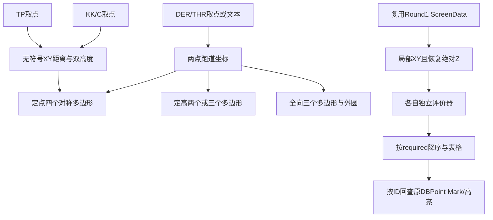

# A7 传统离场：静态恢复

证据来源分开登记：原始元数据/token/RVA为直接证据；`evidence/*.source.txt`是处理后反编译；`*.il.txt`及本文等价代码为IL/调用交叉恢复；纯算法测试只验证恢复实现，不是原程序运行证据。本轮无业务L3。规范基线AC-97-FS-005（民航规〔2020〕12号）；旧常数的历史依据“实现依据待确认”。

三种模式采用三个不同业务类。入口到边界/评价的直接链如下（P为处理token，原token和RVA见event-map和methods.json）：

| 模式 | CAD入口 | 评价入口 | 构造 / 边界 / 评价 |
|---|---|---|---|
| 定高 | P283 | P282 | P1FB / P1FD / P1FC |
| 定点 | P28C | P28D | P202 / P204 / P203 |
| 全向 | P290 | P291 | P420 / P422 / P421 |

共同使用跑道构造P281→PAC；转换PAD。参数模型P793与A1等调用的转弯参数模型相同；这不等于共享螺旋构造。定高/定点只消费Altitude/TAS/Wind，不消费参数模型的Radius/Rate/WindRadius来生成螺旋。全向不构造此转弯参数模型。

详细结论见runway-coordinate、point-turn、altitude-turn、omnidirectional、obstacle-evaluation和cad-output-map。可编译算法见相邻Recovered.cs。未恢复的界面装配/运行验证不可因算法编译成功而消失。
