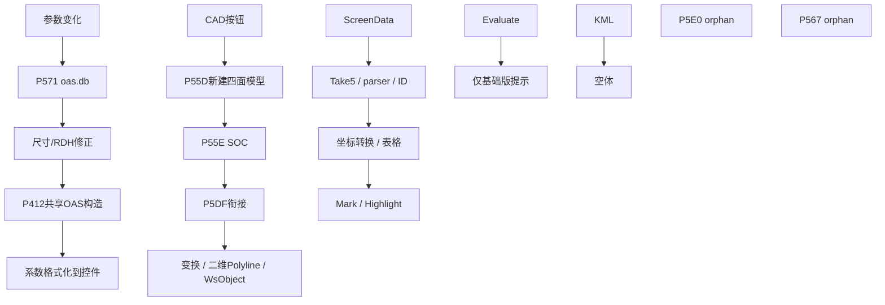

# 完整事件图

静态 bound/reachable 不等于当前配置、许可或显示状态下实际可点击。

|Control.Event|原方法 / RVA|处理方法 / RVA|直接内部 callees|状态|
|---|---|---|---|---|
|comboCat.SelectedIndexChanged|0x06000569 / 0x8C38C|0x06000568 / 0x72488|0x06000581@IL_0001; 0x0600056A@IL_005B|reachable；HL类别→显示重算|
|textBoxWing.KeyPress|0x0600057B / 0x8DEFC|0x0600057A / 0x4F81|0x06000582@IL_0001; 0x06000570@IL_0019|reachable；Enter→P570|
|textBoxWing.Validated|0x0600057C / 0x8DFA4|0x0600057B / 0x4F77|0x06000570@IL_0003|reachable；Validated→P570|
|textBoxRDH.KeyPress|0x0600057B / 0x8DEFC|0x0600057A / 0x4F81|0x06000582@IL_0001; 0x06000570@IL_0019|reachable；Enter→P570|
|textBoxRDH.Validated|0x0600057C / 0x8DFA4|0x0600057B / 0x4F77|0x06000570@IL_0003|reachable；Validated→P570|
|comboBoxCat.SelectedIndexChanged|0x06000578 / 0x8DC70|0x06000577 / 0x7346C|0x06000581@IL_0009; 0x06000581@IL_0025; 0x06000888@IL_004E; 0x06000888@IL_006C; 0x06000581@IL_0084; 0x06000888@IL_00A6; 0x06000581@IL_00D2; 0x06000888@IL_013A; 0x06000582@IL_0163; 0x06000888@IL_0175; 0x06000886@IL_018B; 0x06000582@IL_01A9; 0x06000570@IL_01F6|reachable；尺寸默认值→P570|
|textBoxWheel.KeyPress|0x0600057B / 0x8DEFC|0x0600057A / 0x4F81|0x06000582@IL_0001; 0x06000570@IL_0019|reachable；Enter→P570|
|textBoxWheel.Validated|0x0600057C / 0x8DFA4|0x0600057B / 0x4F77|0x06000570@IL_0003|reachable；Validated→P570|
|LocDistance.KeyPress|0x0600057B / 0x8DEFC|0x0600057A / 0x4F81|0x06000582@IL_0001; 0x06000570@IL_0019|reachable；Enter→P570|
|button18.Click|0x0600057E / 0x8E114|0x0600057D / 0x73724|0x06000581@IL_0001; 0x06000886@IL_0011; 0x06000582@IL_003E; 0x06000581@IL_0043; 0x06000888@IL_008A; 0x0600009C@IL_009E; 0x06000888@IL_00A8; 0x0600009E@IL_00C4; 0x06000582@IL_00C9|reachable；选中行→原DBPoint→obst/Altitude|
|button10.Click|0x0600057D / 0x8DFB8|0x0600057C / 0x73680|0x06000582@IL_005D|reachable；交换六坐标字符串|
|button7.Click|0x0600056A / 0x8C464|0x06000569 / 0x4F6F|0x0600056A@IL_0001|reachable；HL显示重算|
|button2.Click|0x0600056C / 0x8C5C4|0x0600056B / 0x725B0|0x06000582@IL_0001; 0x06000886@IL_000E; 0x06000552@IL_002D; 0x06000888@IL_003E; 0x06000582@IL_0049; 0x06000581@IL_009D; 0x06000888@IL_00C0; 0x06000561@IL_00E0|reachable；GetEntity→XData[1]→P561|
|comboBoxMissCG.SelectedIndexChanged|0x0600057A / 0x8DEE8|0x06000579 / 0x4F77|0x06000570@IL_0003|reachable；MissCG→P570|
|buttonLoad.Click|0x06000561 / 0x8B088|0x06000560 / 0x71584|0x06000888@IL_000C; 0x06000888@IL_001C; 0x06000581@IL_0030; 0x06000581@IL_0038; 0x06000888@IL_0045; 0x06000561@IL_007B|reachable；TXT文件选择→P561|
|LocDistance.Validated|0x0600057C / 0x8DFA4|0x0600057B / 0x4F77|0x06000570@IL_0003|reachable；Validated→P570|
|FormPbnIlsEvl.Load|0x06000554 / 0x897E8|0x06000553 / 0x7044C|0x06000582@IL_0000; 0x06000581@IL_0005; 0x06000888@IL_0052; 0x06000888@IL_005C; 0x060000F6@IL_0061|reachable；初始化组合框→config.xml load|
|button4.Click|0x0600055B / 0x8A538|0x0600055A / 0x70E40|0x06000581@IL_0000; 0x06000582@IL_0005; 0x06000552@IL_0021; 0x06000581@IL_002E; 0x06000888@IL_003A; 0x06000113@IL_003F|reachable；跑道末端 GetPoint|
|button5.Click|0x0600055A / 0x8A3E8|0x06000559 / 0x70D8C|0x06000552@IL_0014; 0x06000581@IL_001B; 0x06000581@IL_002A; 0x06000888@IL_0036; 0x06000113@IL_003B|reachable；THR GetPoint|
|checkBoxShowOas.CheckedChanged|0x06000570 / 0x8CACC|0x0600056F / 0x2B6A||stub；OAS勾选变化空体|
|button8.Click|0x0600056E / 0x8C978|0x0600056D / 0x2B6A||stub；KML空体；设计器隐藏|
|dataGridView1.CellClick|0x0600056F / 0x8C984|0x0600056E / 0x7278C|0x06000581@IL_0001; 0x060000B0@IL_0080; 0x060000AF@IL_0085; 0x06000582@IL_008A|reachable；ID回查、取消旧高亮再高亮；不居中|
|button6.Click|0x0600055D / 0x8A970|0x0600055C / 0x710AC|0x06000886@IL_0005; 0x06000804@IL_000F; 0x06000804@IL_0014; 0x06000888@IL_002B; 0x060007D4@IL_0030; 0x060007FD@IL_0035; 0x06000888@IL_004B; 0x060007D4@IL_0050; 0x060007FF@IL_0055; 0x06000888@IL_006B; 0x060007D4@IL_0070; 0x06000801@IL_0075; 0x06000888@IL_008B; 0x060007D4@IL_0090; 0x060007FD@IL_0095; 0x06000888@IL_00AB; 0x060007D4@IL_00B0; 0x060007FF@IL_00B5; 0x06000888@IL_00CB; 0x060007D4@IL_00D0; 0x06000801@IL_00D5; 0x060000AC@IL_00DB; 0x060005DD@IL_00E1; 0x06000581@IL_00E8; 0x06000581@IL_00F0; 0x0600055D@IL_00F9; 0x06000581@IL_00FE; 0x06000805@IL_0126; 0x06000821@IL_0131; 0x06000827@IL_013B; 0x060007FC@IL_0141; 0x060007FE@IL_0147; 0x06000805@IL_0155; 0x06000823@IL_015A; 0x06000565@IL_0167; 0x06000087@IL_016C; 0x06000888@IL_0176|reachable；新建模型、衔接、变换、二维writer|
|comboBoxGP.SelectedIndexChanged|0x06000579 / 0x8DED4|0x06000578 / 0x4F77|0x06000570@IL_0003|reachable；GP→P570|
|comboBoxAppType.SelectedIndexChanged|0x06000577 / 0x8DB38|0x06000576 / 0x733E8|0x06000581@IL_000F; 0x06000570@IL_005D; 0x06000582@IL_0062|reachable via setter；AppType设计器禁用；WS显隐→P570|
|button1.Click|0x06000565 / 0x8B864|0x06000564 / 0x71B28|0x06000565@IL_0001; 0x06000582@IL_0007; 0x06000581@IL_000C; 0x06000888@IL_0023; 0x06000888@IL_0063; 0x06000888@IL_007C|reachable；P565→TXT|
|FormPbnIlsEvl.FormClosed|0x06000555 / 0x89900|0x06000554 / 0x704C0|0x06000582@IL_0000; 0x06000581@IL_0005; 0x06000582@IL_000D; 0x06000888@IL_001A; 0x06000888@IL_0024; 0x060000F4@IL_0029; 0x060000B0@IL_003F|reachable；config save/取消高亮|
|buttonAix.Click|0x0600055C / 0x8A688|0x0600055B / 0x70EF8|0x06000886@IL_0005; 0x06000581@IL_0010; 0x06000804@IL_0034; 0x06000804@IL_0039; 0x06000888@IL_0050; 0x060007D4@IL_0055; 0x060007FD@IL_005A; 0x06000888@IL_0070; 0x060007D4@IL_0075; 0x060007FF@IL_007A; 0x06000888@IL_0090; 0x060007D4@IL_0095; 0x060007FD@IL_009A; 0x06000888@IL_00B0; 0x060007D4@IL_00B5; 0x060007FF@IL_00BA; 0x060000AC@IL_00C0; 0x0600012F@IL_00EC; 0x06000582@IL_00F4; 0x06000581@IL_0103; 0x060000AD@IL_010D; 0x06000405@IL_0116; 0x060007FC@IL_011E; 0x060007FD@IL_0123; 0x060007FE@IL_012B; 0x060007FF@IL_0130; 0x06000888@IL_0163; 0x06000888@IL_017C; 0x06000558@IL_018D|reachable；转换XY、保留绝对Z→结果表；无评价|
|button3.Click|0x06000556 / 0x899C0|0x06000555 / 0x70514|0x06000581@IL_0000; 0x06000582@IL_0005; 0x06000581@IL_000D; 0x06000886@IL_0019; 0x2B00000D@IL_005C; 0x06000582@IL_0066; 0x06000581@IL_006B; 0x06000888@IL_0089; 0x2B000016@IL_009C; 0x2B000017@IL_00A1; 0x06000888@IL_00C2; 0x06000888@IL_00DF; 0x06000556@IL_00F5|reachable；SelectAll POINT→Take(5)→初始表|
|buttonEvl.Click|0x06000567 / 0x8BBC8|0x06000566 / 0x4A1E|0x06000888@IL_0005|prompt-only；基础版不支持；设计器隐藏|

## 调度断点

P557 自定义解析器、P567 最低标准后处理、P5E0 专用面评价器：全程序集直接 call/callvirt/newobj/ldftn 及 MethodSpec 解析未找到 incoming。共享 P41B 点评价同样没有全局静态调用。P56C 是旧 AppType 显隐方法，未绑定；实际绑定的是 P576。嵌套 P585 只返回 DH，找不到业务使用，不能据此宣称已实现排序或控制障碍物选择。

静态事件遍历含三处 MethodSpec 解析，详见 [reachability.csv](evidence/reachability.csv)、[resolved-global-incoming.csv](evidence/resolved-global-incoming.csv)、[all-incoming.json](evidence/all-incoming.json)、[callgraph.dot](evidence/callgraph.dot)。无反射或运行验证，结论限定为所给程序集的静态引用。

没有 turn point/turn-end/direction 的事件、字段或 reader；全控件引用见 [control-references.csv](evidence/control-references.csv)。原始命令 Y54_PBN_ILS 是 P06A；它构造 P551 并 ShowModelessDialog。

证据等级：E0 原件身份/元数据；E1 去混淆/反编译；E2 IL、字段和调用恢复；E3 独立恢复源码测试；E4 原插件运行，本轮无；N 规范对照/解释。原始 DLL 中的保护桩不能当作明文算法事实。Pxxx 是处理后 MethodDef 0x06000xxx 的简写。

## 关键定位

|P|原 MethodDef / RVA|处理 RVA|反编译行|
|---|---|---|---|
|P06A|0x0600006B / 0x3D34|0x2D2C|615|
|P551|0x06000552 / 0x8973C|0x4F00||
|P566|0x06000567 / 0x8BBC8|0x4A1E|61492|
|P567|0x06000568 / 0x8BBEC|0x71DB0|61497|
|P56C|0x0600056D / 0x8C7EC|0x726C0|61874|
|P56D|0x0600056E / 0x8C978|0x2B6A|61904|
|P5E0|0x060005E1 / 0xB36EC|0x84CAC|71916|

完整原/处理 IL、哈希及签名见 [method-index.csv](evidence/method-index.csv)、[signatures.csv](evidence/signatures.csv)；IL 按 token 存于 evidence/raw 与 evidence/processed，源码摘录存于 evidence/methods。
