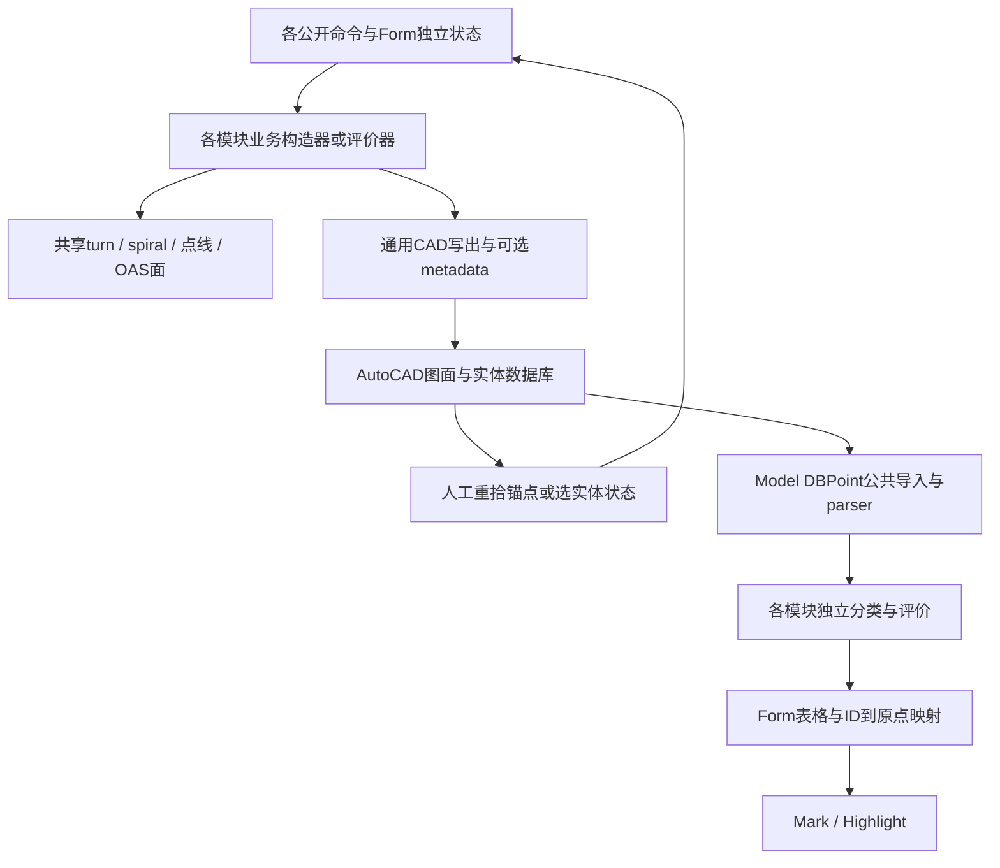

# 最终系统架构：恢复到的事实

## 1. 总体组织与统一模型

**No unified Procedure Model evidenced.** 现有证据支持“AutoCAD共享工作面 + 各Form的输入/表格/临时业务对象 + 共用几何/障碍物/状态helper”。没有证据显示以统一Procedure对象保存航段、设施、保护区主副区语义、前后拓扑及评价结果并自动跨窗传递。

图中“各模块评价”仅表示实际关系：A5/B3/B4/B5的孤立体不因此变成可达入口。见 [构建限制](<C:/Users/ZJ/Desktop/固定翼航空器飞行程序-工程大/飞行程序设计系统开发/recovered/final-static-baseline/build-limitations.md>)。

## 2. AutoCAD的角色及跨窗传递

AutoCAD保存可见几何、Model障碍物点、Group和局部状态字符串，也供设计者观察与重拾。图面不是已恢复出的统一程序拓扑数据库。A2→A7的TP/C、A3→A7的KK均重新GetPoint，不从WsCalcuLine/Group恢复前序业务对象。A3→A6/A10无直接业务reader，A10自己构造DME弧。

## 3. 哪些metadata被读

A1选实体取状态，A5 P318、B3 P483、B4 P56B通过人工GetEntity读取XData数组第二项并恢复参数/控件。缺少严格RegApp/schema校验，不能视为自动识别保护区角色。公共障碍物parser自动尝试WsEntityFrame名称，这只复用名称。A2的WsCalcuLine reader P655仅通过wrapper6AB，wrapper无indexed incoming；未证明业务自动消费者。B5主writer传空description，不写业务XData。

证据：[WsCalcuLine调用审计](<C:/Users/ZJ/Desktop/固定翼航空器飞行程序-工程大/飞行程序设计系统开发/recovered/A2-BasicCalculation/evidence/WsCalcuLine-downstream.json>)；[A5](<C:/Users/ZJ/Desktop/固定翼航空器飞行程序-工程大/飞行程序设计系统开发/recovered/A5-PrecisionApproach/xdata-schema.md>)；[B3](<C:/Users/ZJ/Desktop/固定翼航空器飞行程序-工程大/飞行程序设计系统开发/recovered/B3-RnpApch/xdata-schema.md>)；[B4](<C:/Users/ZJ/Desktop/固定翼航空器飞行程序-工程大/飞行程序设计系统开发/recovered/B4-PbnIls/xdata-schema.md>)；[B5](<C:/Users/ZJ/Desktop/固定翼航空器飞行程序-工程大/飞行程序设计系统开发/recovered/B5-PbnDeparture/xdata-schema.md>)。

## 4. 障碍物公共层

P10D选择Model空间DBPoint；P12F读取原XYZ、调用者ordinal ID、可选WsEntityFrame名称或后缀回退。各Form维护ID到原DBPoint字典，再由自身分类器计算。Mark用原点与原Z写块属性，Highlight也回到原实体。RandomPoint只创建DBPoint+MText，没有统一树高合成或自动属性框架记录。B3无Take5；B4/B5在parser前截前5点，连带限制表、字典、Mark和高亮。其评价UI未调度，不能声称实际评价已覆盖这些点。

证据：[属性与解析](<C:/Users/ZJ/Desktop/固定翼航空器飞行程序-工程大/飞行程序设计系统开发/recovered/ObstacleData/WsEntityFrame-schema.md>)、[Mark](<C:/Users/ZJ/Desktop/固定翼航空器飞行程序-工程大/飞行程序设计系统开发/recovered/ObstacleData/marker.md>)、[Take5及边界](<C:/Users/ZJ/Desktop/固定翼航空器飞行程序-工程大/飞行程序设计系统开发/recovered/B4-PbnIls/obstacle-evaluation.md>)。

## 5. OAS公共层

A5/B4共享OasModel P411–P41E与Plane P834–P840及CAD helper。数据库loader/decoder/尺寸/RDH包装是A5 P409–40C与B4 P571–574两个实现；同schema不是同MethodDef。A5六模式与B4同轴固定宽度衔接几何不同。A5参数为四段JSON，B4旧文本格式不同；A5没有自有HL，不能用B3/B4公式填补。

证据：[共享身份](<C:/Users/ZJ/Desktop/固定翼航空器飞行程序-工程大/飞行程序设计系统开发/recovered/A5-PrecisionApproach/class-map.md>)、[格式](<C:/Users/ZJ/Desktop/固定翼航空器飞行程序-工程大/飞行程序设计系统开发/recovered/A5-PrecisionApproach/persistence.md>)、[HL负向证据](<C:/Users/ZJ/Desktop/固定翼航空器飞行程序-工程大/飞行程序设计系统开发/recovered/A5-PrecisionApproach/hl-correction.md>)。

## 6. Turn与Wind spiral公共层

P793/P854提供turn输入与派生参数，模块只消费所需字段。A7实际用TAS等，不使用spiral构造；B3为TAS消费；B4核心无P793。A1/B1/B2以及B5、A6部分模板复用Spiral86；Holding/Base使用Spiral88。A6两spiral角度成员P7AF/P7C2真实存在，与A1标签common tangent及点到spiral P7AD不能混为一谈。

证据：[turn](<C:/Users/ZJ/Desktop/固定翼航空器飞行程序-工程大/飞行程序设计系统开发/recovered/shared-turn-methods.md>)、[spiral身份与调用](<C:/Users/ZJ/Desktop/固定翼航空器飞行程序-工程大/飞行程序设计系统开发/recovered/A6-Template/shared-geometry.md>)、[A7负向闭包](<C:/Users/ZJ/Desktop/固定翼航空器飞行程序-工程大/飞行程序设计系统开发/recovered/A7-Departure/final-static-closure.md>)。

## 7. 共享与复制边界

B1/B2共享primitive但有独立候选/业务构造器；A7/B5共享frame/基础设施但不是同一离场类；A9/B3有相似线性副区数学而非同评价器；B3/B4 HL包含GP项和舍入差异。完整分项见 [共享/复制表](<C:/Users/ZJ/Desktop/固定翼航空器飞行程序-工程大/飞行程序设计系统开发/recovered/final-static-baseline/shared-vs-copied-final.csv>)与 [跨窗流表](<C:/Users/ZJ/Desktop/固定翼航空器飞行程序-工程大/飞行程序设计系统开发/recovered/final-static-baseline/cross-window-data-flow.csv>)。
