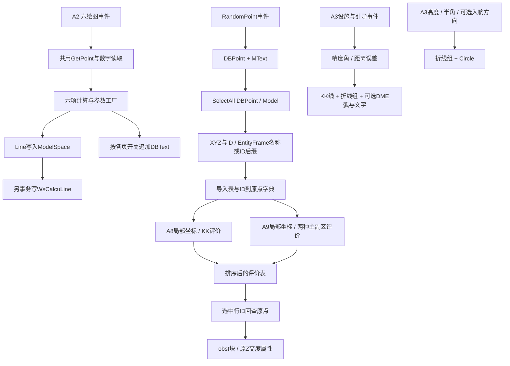

# 第一轮原生事件与障碍物链增量（2026-10-27）

后续Closure更新见[round1-closure.md](round1-closure.md)：19文件通过25.1兼容编译；目标副本映像已加载，但RCL不可用，业务实验未执行。本文“未编译/未运行/无宿主”为增量产生时的历史状态；调用图和IL恢复结论保留。

本次继续既定 A2 → 障碍物公共链 → A3 范围。**仍不能将完整第一轮标为验收完成。** 原件只读；未运行原始或处理后 DLL，未启动 AutoCAD，无 L3。规范基线仍为 AC-97-FS-005、民航规〔2020〕12号，未据规范改写旧算法。

## 新保存的可审计成果

| 文件 | 恢复内容 | 验证边界 |
|---|---|---|
| A2-BasicCalculation/BasicCalculationForm.Events.Recovered.cs | 六个 CAD 事件、公式回填、HL修正/类别事件、文字布局、现有计算事件注册 | 原生条件分支未编译；不含完整 designer/config |
| A2-BasicCalculation/TurnParameterInput.Recovered.cs | 原转弯参数构造、TAS/率/半径、诊断输出、控件读取与单位选择 | 原生分支未编译；自定义单位选择控件尚待接回 |
| CadInteraction.Recovered.cs | 取点重试/取消、两种数字读取、错误颜色/焦点 | 来源 --/--.cs:83668/83681/83738、-/-.cs:5236 |
| ObstacleData/ObstacleCad.Recovered.cs | SelectAll、DBPoint解析、块导入/插入/属性赋值 | 无真实DWG块布局/宿主验证 |
| ObstacleData/EntityFrameCad.Recovered.cs | 新增从实体读取 WsEntityFrame 的事务链 | 沿用已测序列化；原生API未编译 |
| ObstacleData/RandomPointForm.Events.Recovered.cs | 中心拾取→随机取样→DBPoint与MText | 无配置事件/完整designer |
| ObstacleData/TurnAreaForm.Events.Recovered.cs | A8导入→局部坐标→KK评价→排序/表格→选中行Mark | 仅障碍物路径，不是完整A8 |
| ObstacleData/PriSec.Recovered.cs | A9两种主副区判断、线宽插值、MOC衰减、OCA | 新增19项数值/边界检查通过；无原程序等价实验 |
| ObstacleData/PriSecForm.Events.Recovered.cs | A9导入→评价→排序/显示坐标→Mark | 原生未编译 |
| ObstacleData/ScreenData.OtherForms.Recovered.cs | 其余五窗的导入、原表结构和Mark；B4/B5实际评价按钮提示 | 不是五套评价算法的完整移植 |
| A3-FixTolerance/FixToleranceForm.Events.Recovered.cs | 两个绘图事件、设施/引导/半角/开关事件、Polyline分组 | 原生未编译；无完整designer/config |

`native-port-map.csv` 保存78个方法切片到原/处理token、RVA、阅读副本行的对应。它包括同一原方法的不同切片，**不是完成率**。`audit_native_ports.py` 可重建此表。`package_evidence.py` 更新逐方法IL与摘录，补入旧声明索引漏掉的泛型SelectAll helper和转弯模型构造器。

所有 friendly 类/字段名及 AttachCalculationEvents 都是恢复成果的可维护命名/接线辅助，不是声称原程序集存在同名类型或新 MethodDef。Form 控件字段为绑定位置，未构造新界面，也未生成可安装插件。

## 新核对出的旧行为

1. FAF、复飞TP、离场TP逐次检查 Origin；NPA、PA、C拾取两点以后只检查相等。单次取消加另一个非零点，后三者仍可能继续画线。恢复时未增加统一取消保护。
2. PA不仅沿航迹负方向定位；`ThrSocDistance` 元数据也接收负距离。HLcor=0时计算返回−1，CAD继续使用取负后的+1；未添加停止绘图条件。
3. 数字读取的失败一般返回0并提示，TextBox版本还聚焦并标LightCoral；不等于停止事件。转弯控件reader的失败返回null，调用方没有统一null保护。
4. NPA/C事件先读一次转弯参数，公式又读一次。两次构造和诊断输出被保留，不能用一次纯数值计算声称事件等价。
5. A2 `comboXz.TabIndexChanged` 绑定到PA绘图事件；机场标高Validated执行类别事件，重新填HLm/HLr。没有清理这些旧注册。
6. A3盲区非法数字catch未恢复Visible；DME后缀框（字段 `_0096_0097`，早期Name为textBox2）的Leave绑定NDB半角事件。NDB选中时离开此框会写40并切换示意图。它不是HalfAngle.Leave。
7. A3在KK生成之后才追加折线组；DME三弧另组。Group以AddDBObject注册，没有补造命名组字典。折线/KK为Z0；弧/圆保留所拾圆心Z。
8. A9普通模式排除起终站，IF模式包含；IF主区终宽用完整终宽，普通模式用半终宽。原线除零helper返回±1000000，不应改成Infinity。评价表显示`-localX/-localY`；Mark仍回查原DBPoint。
9. B4/B5导入超过5个点后提示并Take(5)，顺序沿SelectAll返回序列；不是按高度或危险程度先排序再截取。B3没有此截取。
10. B4主评价按钮处理后566只是“基础版不支持此功能。”；B5处理后501只是“请指定转弯点。”。窗口内还有其他评价方法，不能据按钮占位直接断言整个窗口没有评价实现。
11. 表头保留差异：A8为ds/MCG，A7为dr/minPDG；B5导入表没有“所属区域”列且表头写“程序高度(%)”。未改成更合理的单位。

以上1–11为 L1处理代码及L2交叉定位结论；没有将UI推测或规范规则提升为源码事实。常数的历史规范依据仍“实现依据待确认”。

## 调用/事件链

五个其他窗口已移植ScreenData/Mark路径，未接入图中A8/A9的评价器。xInfo仍独立读全部XData，不将其输出当成业务模型输入。

## 人工交互与自动化判断

| 交互 | 用户提供的业务对象 | 下游消费 | 已有数据可否推导 |
|---|---|---|---|
| A2两点 | 入口/DER/SOC等坐标及方向 | 平面航迹角、沿程施工中心 | 有设施/程序坐标时可以，属L4；当前事件未读取统一程序对象 |
| RandomPoint中心 | 生成区域中心 | 随机XY平移 | 已有区域数据时可指定，属L4；不是障碍物实体选择 |
| xInfo GetEntity | 需要探查的任意实体 | 全部XData打印 | 必须知道待探查对象；非自动障碍物导入 |
| ScreenData SelectAll | 无手工选择 | 全Model DBPoint，B4/B5额外Take(5) | 已代码化；未按真实业务IsObstacle筛选 |
| Mark SelectedRows | 要标记的结果行 | ID→原DBPoint→BlockReference | 可按显式输出规则选择行，属L4；当前保留用户决定 |
| A3两点/附加入航点 | 电台坐标、航迹方位/距离 | 容差顶点、KK及盲区航迹线 | 有设施与航迹数据时可推导，属L4；当前没有验证对象身份 |

“软件为什么未自行确定”没有作者直接证据；能证明的是这些路径不从统一程序对象取基准。没有把设计意图猜测写成实现事实。

## 尚未闭合

- AutoCAD 23.1引用仍缺；全部AUTOCAD条件代码未编译/未运行。不能通过关闭条件编译来宣称原生编译成功。
- 完整designer、资源及config加载/保存、单位选择控件自身事件尚未迁入这些partial文件；已有原始事件/控件索引保留。
- A7/A10/B3/B4/B5的其他评价入口、保护区几何与完整area→MOC→OCA过程仍有未恢复项，不把A8/A9算法推广过去。
- WsSymbol2.1.dwg内部块/属性定义未独立读取；现阶段能复现插入算法和属性写入，不能保证符号布局已恢复。
- XData普通原始类型已测，旧CAD实体真实JSON、对象Properties内任意类型兼容、原生事务及异常行为未做宿主验证。

下一步仍是静态恢复和上述缺口核对；不因此重构原系统或开发新软件。
